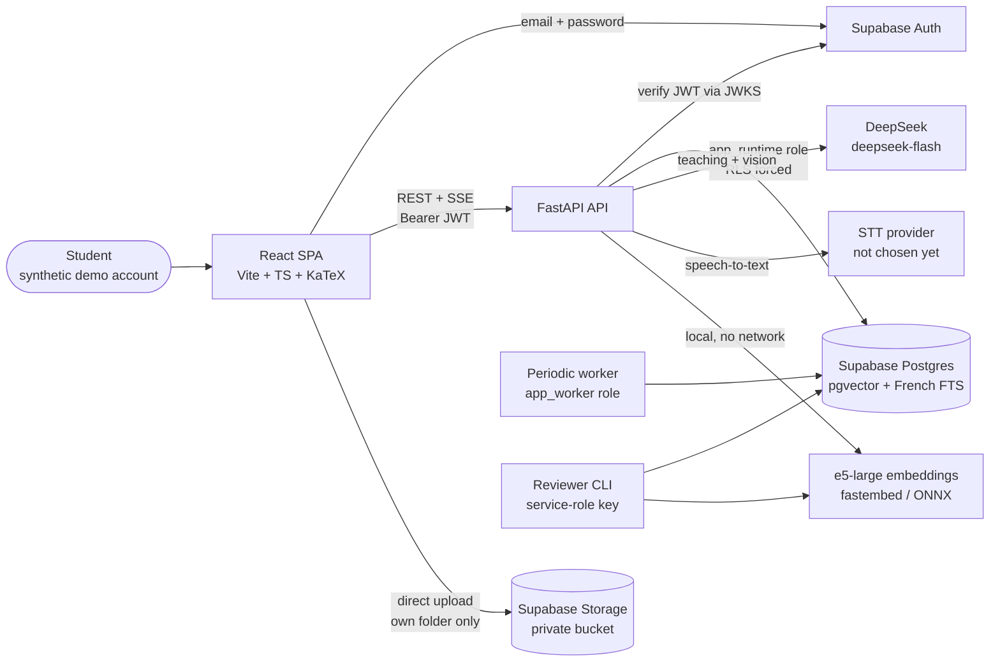
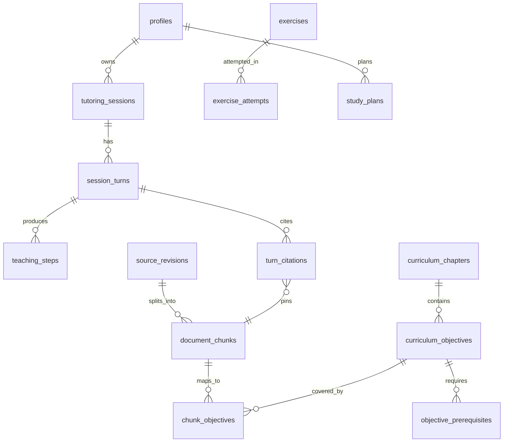
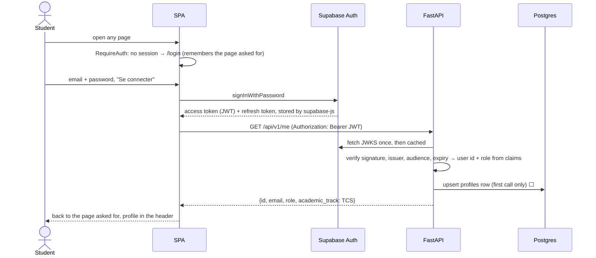
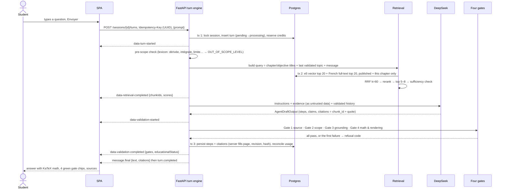
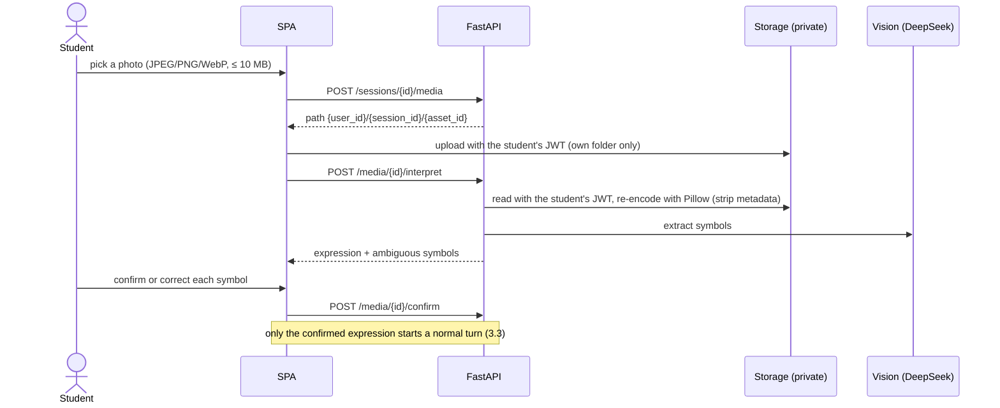
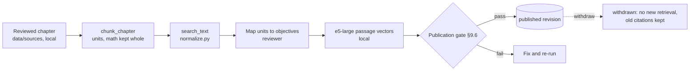

# Architecture and end-to-end flows

- **Updated:** 2026-11-28 (end of Week 3 for Yassine; Imran's frontend Weeks 1–3 merged)
- **What this is:** one page that shows how every part of the AI Mathematics Tutor fits together, and what happens step by step in each user flow, from the first click to the last database write.
- **What this is not:** the source of truth. Rules and numbers come from [implementation-plan.md](implementation-plan.md) (cited as §), the [contracts](contracts/), and the [ADRs](adr/). If this page disagrees with them, they win; fix this page.

**Status legend:** ✅ built and tested · 🟨 partly built · ⬜ planned (week and owner given).

**How to read it (new team member):** read section 1 for the big picture, then the flow in section 3 that touches your work, then section 4 for the rules every part must follow (security, credits, config, tests). Words you don't know are in the glossary (section 6). Each part names its owner: ask them.

## 1. System map

### Trust boundaries (§4.4)

| Zone | Trusted? | Holds | Never holds |
| --- | --- | --- | --- |
| Browser (SPA) | No | Supabase anon key, the student's JWT | Service-role key, any AI provider key |
| FastAPI | Yes, authoritative | Identity, scope, retrieval, the four gates, persistence | — |
| AI provider output | No | Draft text only | The right to pick scope, chapter, roles or DB actions |
| Retrieved book chunks | No (data, not instructions) | Evidence | Instructions to the model |
| Reviewer CLI | Privileged, local only | Service-role key (`AdminSettings`) | — and it is never reachable from the SPA |
| Database | Durable state | Everything persistent; RLS on every table | Direct student reads of `chunk_text` |

## 2. Components

### 2.1 Frontend (`frontend/src/`, owner Imran)

| Component | Job | Status |
| --- | --- | --- |
| `lib/env.ts` | The only reader of the 3 `VITE_` variables; blocks start-up if one is missing | ✅ |
| `lib/supabase.ts`, `lib/auth.ts` | Supabase login, logout, session expiry, French messages | ✅ |
| `lib/http.ts`, `lib/api.ts` | `fetch` with base URL, Bearer token, timeout, typed `ApiError`; 401 → session ended | ✅ (`/me` only) |
| `lib/sse.ts`, `chat/useTurnChat.ts` | Reads the turn stream; shows text only after `message.final` | ✅ against the contract; backend endpoint ⬜ |
| `auth/AuthProvider`, `RequireAuth`, `AuthErrorScreen` | Session state, route guard, `/me` errors | ✅ |
| `chat/*` (`Transcript`, `TutorTurn`, `GateStatus`, `CitationList`, `RefusalBanner`, `Composer`, `TurnProgress`) | The classroom conversation | ✅ (fixtures) |
| `math/MathText` | KaTeX with an allowlist; unsafe math replaced by a French notice | ✅ |
| `media/PushToTalk`, `useRecorder`, `PhotoPicker` | Microphone capture (< 500 ms stop), photo checks (type, 10 MB) | 🟨 capture only; upload ⬜ Week 7 |
| Pages: Login, Classroom, Session, Practice, StudyPlan, History | Routes | 🟨 Practice / StudyPlan / History are placeholders (Weeks 9–11) |

Details: [frontend/component-boundaries.md](frontend/component-boundaries.md), tests: [frontend/e2e-matrix.md](frontend/e2e-matrix.md).

### 2.2 Backend (`backend/`, owners per D-47)

| Module | Job | Owner | Status |
| --- | --- | --- | --- |
| `app/config.py` | Single settings module; fails fast on missing env | Mohamed | ✅ |
| `app/auth/dependencies.py` | Verifies the Supabase JWT (JWKS, issuer, audience `authenticated`) | Mohamed | ✅ |
| `app/api/health.py`, `auth.py` | `/health`, `/ready`, `GET /api/v1/me` | Mohamed | ✅ (`/me` profile upsert ⬜ Week 3) |
| `app/database/` + `alembic/` | SQLAlchemy models, migrations, RLS | Mohamed | 🟨 scaffold; tables ⬜ Weeks 3–5 |
| `app/classroom/` (`engine`, `streaming`, `idempotency`) | Turn state machine, SSE, `Idempotency-Key` | Mohamed | ⬜ Week 6 |
| `app/assistant/turn_contract.py` | Which events a turn emits and what they carry | Yassine | ✅ |
| `app/assistant/` (`agent`, `prompts`, `instructions.md`) | PydanticAI tutor with bounded tools | Yassine | ⬜ Week 6 |
| `app/retrieval/normalize.py`, `fusion.py` | Search normalization, RRF (k = 60) | Yassine | ✅ |
| `app/retrieval/` (`queries`, `retriever`) | Scoped hybrid search in Postgres, reranker, sufficiency | Yassine | ⬜ Week 4 |
| `app/validation/draft.py`, `refusal.py` | Draft-output models, 12 refusal codes + French texts (frozen) | Yassine | ✅ |
| `app/validation/` (4 gates, `pipeline`) | Source, scope, grounding, math & rendering gates | Yassine | ⬜ Weeks 6–7 |
| `app/providers/` | Adapters: LLM (DeepSeek), vision, STT, storage | Yassine (STT), Mohamed | ⬜ Weeks 6–7 |
| `app/practice/`, `api/practice.py` | Exercise evaluator, attempts, `GET /progress` | Yassine (D-47) | ⬜ Week 9 |
| `app/planning/` | Planner rules (Yassine); tables + API (Imran, D-47) | Yassine + Imran | ⬜ Week 10 |
| `app/budget/`, `app/jobs/` | Credit ledger, periodic worker | Mohamed | ⬜ Weeks 6–11 |
| `ingest/chunking.py` | Book chapter → chunks by pedagogical unit | Yassine | ✅ |
| `ingest/` (CLI, publish) | Review, map objectives, embed, publish, withdraw | Yassine + Mohamed | ⬜ Week 5 |
| `scripts/retrieval_spike.py`, `retrieval_grading.py`, `run_evaluation.py` | Retrieval metrics, label grading, 20+20 evaluation runner | Yassine | ✅ |

### 2.3 Data (§5, [retrieval-schema.md](contracts/retrieval-schema.md))

Static content (curriculum, chunks, exercises) is published by the reviewer and read-only to students. Student data (sessions, turns, attempts, plans) is owner-only through RLS. Today the repo holds the content side as files: [coverage-matrix.json](curriculum/coverage-matrix.json) (✅ 22 objectives), [data/seed/](../data/seed/) (✅ CC0 seed), [evaluation/cases.json](evaluation/cases.json) (✅).

## 3. Flows, start to end

### 3.1 Log in

1. **Open the app.** `RequireAuth` sees no Supabase session and sends the student to `/login`, keeping the page they wanted.
2. **Submit the form.** Email and password only; no Google or SSO (§6.1). Wrong credentials give a French error and stay on the form.
3. **Supabase signs in** and returns a JWT. `supabase-js` stores and refreshes it; the SPA never sees a password again.
4. **`GET /me`.** `http.ts` adds `Authorization: Bearer <JWT>` to every API call.
5. **FastAPI verifies** the token against Supabase's public keys (JWKS). Role comes from the token's `app_metadata.role`, never from the database (§6.1).
6. **First call creates the profile row** (`id = sub`, `is_synthetic = true`). Every other endpoint can then assume it exists. ⬜ Mohamed, Week 3.
7. **The SPA shows the app.** It waits for `/me` before rendering, so no screen runs without a profile.

**When it goes wrong:** expired session → back to login with "Votre session a expiré"; `/me` 403 → "Accès refusé" (no retry); network error → French message with a retry button; any later API 401 → session ended.

**Status:** frontend ✅ (Playwright `auth.spec.ts`), JWT check ✅, profile upsert ⬜.

### 3.2 Start, reload and manage sessions

A **session** is one conversation about one chapter. It belongs to one student and keeps its whole validated history.

1. **Pick a chapter.** The classroom page lists chapters from `GET /curriculum/chapters` (only published ones), and objectives from `GET /curriculum/chapters/{id}/objectives`. ⬜ Week 5
2. **Create.** `POST /api/v1/sessions {chapterId}` inserts a `tutoring_sessions` row pinned to the chapter's current published revision (`curriculum_revision_id`). The chapter never changes inside a session; another chapter means a new session (§11.5). ⬜ Mohamed, Week 4
3. **Open and reload.** The SPA goes to `/session/:id`. `GET /sessions/{id}` returns the session and its validated history, so a page reload shows the same conversation. Unvalidated text is never stored, so it can never reappear (§5.2). ⬜ Week 4
4. **List.** The history page calls `GET /sessions?limit=20&cursor=…`: newest first, 20 at a time ("cursor pagination": the server gives a bookmark for the next page). ⬜ Week 4
5. **Rename or archive.** `PATCH /sessions/{id}`. Archived sessions leave the main list but stay readable. ⬜ Week 4
6. **Delete.** `DELETE /sessions/{id}` is a soft delete: the row is marked deleted and hidden, not erased, so audit and citations stay consistent. ⬜ Week 4
7. **Limits.** At most 30 questions per session; the 31st gets `TURN_LIMIT_REACHED` (HTTP 409) and the SPA suggests a new session.

RLS makes sure a student only ever lists or opens their own sessions; asking for someone else's ID returns "not found". The two-user isolation tests are ⬜ Week 3 (UI: Imran, server: Mohamed).

### 3.3 Ask a question (the core flow)

Step by step (§8.1, §10, §11):

1. **Send.** The SPA posts only the new prompt with a fresh `Idempotency-Key`. Same key twice returns the stored answer, never a second model call (§7.5).
2. **Claim the turn (short transaction 1).** Rate limit (6/min, 1 at a time, 30 per session), turn row `processing`, worst-case cost reserved on the locked `budget_ledger`. No transaction stays open during a model call (§11.4).
3. **Pre-scope check.** A cheap word list catches obvious 1BAC/2BAC topics before spending credits. It only refuses when the word is outside every objective of the chapter (§8.4).
4. **Build the search query** from chapter/objective titles, the last validated topic, and the normalized message ("et si x est négatif ?" keeps its subject) (§10.6).
5. **Hybrid retrieval (transaction 2).** e5-large `query:` vector → pgvector cosine top 20; `normalize.search_text` → French full-text top 20; both filtered to published chunks of this chapter and its approved objectives ([retrieval-schema.md](contracts/retrieval-schema.md)).
6. **Fuse and check.** RRF k = 60 → reranker (cosine/text score, objective and content-type bonus) → top 5–8 → sufficiency check. Too weak → `INSUFFICIENT_EVIDENCE`, no model call.
7. **Draft.** DeepSeek writes an `AgentDraftOutput` ([draft.py](../backend/app/validation/draft.py)): steps, claims with `objective_id`, and citations as `{chunk_id, quote}` only. It may do at most 3 extra reads to fill a gap.
8. **Four gates.** Source (chunk exists, published, quote really in it, ≤ 25 words) → Scope (objective approved, chunk mapped) → Grounding (each claim supported, found verbatim in the step) → Math & rendering (SymPy check in a killable process, KaTeX allowlist). One failure refuses the whole turn (§8.2).
9. **Persist (transaction 3).** Validated steps and citations; the server copies page, section, revision and hash from the chunk (D-37). Actual usage replaces the reservation.
10. **Stream the result.** Progress parts arrive live; the answer text arrives once, in `message.final`, after validation. The SPA shows nothing from the model before that ([sse-turn-contract.md](contracts/sse-turn-contract.md)).

**Status:** contract ✅ (turn events, draft models, refusal texts frozen), SPA ✅ against fixtures, normalization + RRF ✅; the endpoint, retrieval queries, agent and gates ⬜ Weeks 4–7.

### 3.4 When a turn does not give an answer

| What happened | Student sees | Turn row | Stream ends with |
| --- | --- | --- | --- |
| Out of TCS level / other chapter | French refusal + "que faire ensuite ?" | `completed`, `outside_scope` | `message.final` with `refusalCode` |
| Book has no evidence | "Le manuel validé ne contient pas assez…" | `completed`, `insufficient_evidence` | same |
| Unclear symbol | A focused clarification question | `completed`, `clarification_required` | same |
| Math or rendering gate fails | "Réponse non validée" | `completed`, `validation_failed` | same |
| DeepSeek down | "Service momentanément indisponible", retry button | `failed` | `turn.failed` |
| Credits used up | "Crédits de démonstration épuisés", no retry | `failed` | `turn.failed` |
| Too many questions / session full | Wait or new session | no row | HTTP 429 / 409, no stream |

All texts are fixed French templates ([teaching-contracts.md](contracts/teaching-contracts.md)); the model never writes a refusal. Status: ✅ texts and SPA banners; server side ⬜ Week 6.

### 3.5 Interrupt a turn

1. The student clicks **Stop** (or leaves the page, or presses Enter on Stop).
2. The SPA aborts the stream and calls `POST /sessions/{id}/interrupt`; it ignores any later event carrying the old `turnId`.
3. The server marks the turn `cancelled`, releases the credit reservation, and never stores a partial answer.

Status: SPA ✅ (20 Playwright interruption cases); endpoint ⬜ Mohamed, Week 8.

### 3.6 Photo of an exercise

Raw OCR text never reaches the tutor; an unconfirmed photo never starts a turn (D-38, ADR 0003). Status: SPA picker and checks ✅; upload, vision and confirm ⬜ Week 7.

### 3.7 Push-to-talk voice

1. The student holds **Parler**; the browser records with `MediaRecorder`. Releasing stops the microphone in under 500 ms.
2. The SPA sends the audio to `POST /speech/transcribe`; the STT adapter returns French text. The audio is deleted at once and never stored.
3. The transcript appears **in the question box, editable**. Nothing is sent until the student presses Envoyer, which runs flow 3.3.
4. There is no spoken answer (D-43).

Status: recording ✅ (Playwright `media.spec.ts`); STT adapter ⬜ Yassine, Week 7 (provider not chosen yet).

### 3.8 Practice an exercise

1. `GET /exercises` lists published exercises of the chapter, never their answers (`answer_schema` stays server-side).
2. The student answers (MCQ, a number, or an algebraic expression) and may ask for hints one at a time (`POST /exercises/{id}/hints`).
3. `POST /exercises/{id}/attempts` → the evaluator checks it: option IDs, numeric tolerance, or SymPy equivalence. Unsupported forms give `inconclusive`, never a false `incorrect`.
4. The attempt is stored pinned to the exercise revision, with hint count and error category.
5. `GET /progress` shows objectives practised, repeated errors, and "needs revision" labels — never mastery percentages.

Status: placeholder page ✅; evaluator, API and UI ⬜ Week 9 (Yassine backend, Imran UI).

### 3.9 Study plan

1. The student enters availability windows (time zone `Africa/Casablanca`) and weekly target hours.
2. `PUT /study-plan` → the deterministic planner orders objectives by prerequisites and weak areas into 45-minute blocks with breaks, no overlaps, bounded per day.
3. One transaction replaces the plan: completed tasks survive, and there are never two active plans.
4. `PATCH /study-tasks/{id}` marks a task done or skipped.

Status: placeholder page ✅; planner rules ⬜ Yassine, tables + API + UI ⬜ Imran, Week 10 (D-47).

### 3.10 Put a chapter of the book online (reviewer)

1. The reviewer checks the extracted text against the printed book (done for chapters 1–3 ✅).
2. `chunk_chapter` splits it into pedagogical units, never inside a `$$` block ✅.
3. Each unit gets its objectives (coverage matrix ✅ `coverage-v0.1`); search text and embeddings are computed.
4. The publication gate: academic-use note acknowledged, reviewer sign-off, objectives mapped, math reviewed, that chapter's retrieval set ≥ 10 pairs with Recall@5 ≥ 0.80, embeddings present, hash recorded.
5. Publish → students' sessions can search it. Withdraw → excluded from new searches; existing citations stay readable; new turns in old sessions get `SOURCE_WITHDRAWN`.

Status: chunker, normalization, labels and seed ✅; the CLI and DB publish flow ⬜ Week 5. Chapter 1 publishes first.

### 3.11 Background worker

Runs inside the API process on its own `app_worker` database login (§18.5): recovers turns stuck past `expires_at`, releases leftover credit reservations, deletes expired idempotency keys and abandoned media. Each handler is idempotent and claims rows with `FOR UPDATE SKIP LOCKED`. Status ⬜ Mohamed, Weeks 8–11.

### 3.12 Evaluation run (before release)

1. `scripts/run_evaluation.py` sends the 40 cases of [cases.json](evaluation/cases.json) through the real API, each in a fresh session, exactly like a student ✅.
2. It writes `grading.csv` (gitignored); the reviewer grades it with [rubric.md](evaluation/rubric.md).
3. Release gates: ≥ 18/20 in-scope correct and scoped, 0 unsupported answers on the 20 boundary cases, 100% valid citations.

Status: runner and rubric ✅; first real run needs the Week-6 endpoints.

### 3.13 Profile and admin usage summary

- **Profile.** `GET /me` returns the profile (flow 3.1). `PATCH /me` lets a student change only their display name and preferences; the role can never be changed through the API, because the role comes from the signed token (§6.1). ⬜ Mohamed, Week 3
- **Admin usage summary.** A read-only page for an `admin` account: credits spent and left, turns per day, refusal rate by code, provider errors. It reads aggregate numbers only, never student conversations. ⬜ Imran (page + endpoint) over Mohamed's usage queries, Weeks 10–11 (D-47)

## 4. How the system stays safe, affordable and running

These rules apply to every flow above. If your code breaks one of them, it is a bug, even if the feature works.

### 4.1 Security: five layers

A request must pass all five; each one alone would not be enough.

| # | Layer | What it stops | Where |
| --- | --- | --- | --- |
| 1 | **No secrets in the browser.** The SPA holds only the Supabase anon key and the student's JWT | A stolen browser cannot call DeepSeek or read the database directly | `frontend/src/lib/env.ts` |
| 2 | **JWT verified on every API call** (signature, issuer, audience, expiry) | Fake or expired logins | `app/auth/dependencies.py` ✅ |
| 3 | **Row-Level Security (RLS)** forced on every table. The API connects as `app_runtime` (not the owner, no RLS bypass) and, inside each transaction, sets the verified user ID; every policy compares rows to `public.request_user_id()` | A bug in a route reading another student's data: the database itself refuses | Alembic migrations ⬜ Week 3–5, ADR 0002 |
| 4 | **Service-role isolation.** The all-powerful Supabase service key lives only in `AdminSettings`, used by the reviewer CLI. A test fails CI if any student-facing module imports it | The API ever running with "god mode" | `tests/test_service_role_boundary.py` ✅ |
| 5 | **Untrusted content stays data.** Model output, book chunks, photo text and student messages are never treated as instructions; the four gates check every answer | Prompt injection ("ignore your rules"), fake citations, out-of-scope answers | `app/validation/` ⬜ Weeks 6–7 |

Roles (§6.2): `student` sees only their own data and published content; `reviewer` works through the local CLI and sees no student data; `admin` reads summaries, never impersonates a student; the worker (`app_worker`) gets only the rows it must clean up.

### 4.2 Limits against abuse (§6.5)

| Limit | Value | What happens |
| --- | --- | --- |
| Question length | 4,000 characters | Rejected with a French message |
| Questions per minute | 6 per student | `RATE_LIMITED` (HTTP 429) |
| Questions at the same time | 1 per student | `RATE_LIMITED` |
| Questions per session | 30 | `TURN_LIMIT_REACHED` (HTTP 409) |
| Photo | 10 MB, JPEG/PNG/WebP | Refused in the browser and again by the Storage bucket and the API |

For the single-machine demo the counters live in the API's memory (D-40). Running several API copies would need a database counter instead.

### 4.3 Trial credits: never overspend (§11.3)

The demo runs on trial credits, so a runaway loop must not empty them.

1. **Before** each model call, the worst-case cost is **reserved** on one shared `budget_ledger` row, locked so two requests cannot both pass the limit.
2. **After** the call, the real token cost replaces the reservation (`usage_events`).
3. At **80%** of the budget an alert fires; at **100%** every new question gets `CREDIT_EXHAUSTED` — never a cheaper, unchecked answer.
4. A cancelled or crashed turn releases its reservation (the worker cleans up any it misses).

Today's numbers: 15 benchmark prompts cost $0.0045 in total ([Benchmark.md](Benchmark.md)). Embeddings are local and free (D-44). ⬜ Mohamed, Week 6.

### 4.4 Configuration

- **One settings file per service:** `backend/app/config.py` and `frontend/src/lib/env.ts`. Code never reads environment variables anywhere else, and the app refuses to start if a required one is missing.
- **Three backend settings classes on purpose:** `Settings` (the API), `MigrationSettings` (Alembic only), `AdminSettings` (reviewer CLI only, the only one with the service key).
- **Main backend variables** (full list: [backend/.env.example](../backend/.env.example)):

| Variable | Used for |
| --- | --- |
| `SUPABASE_URL`, `SUPABASE_ANON_KEY` | Verifying logins; base project URL only, no `/rest/v1/` |
| `DATABASE_URL` | Migrations, as the database owner |
| `DATABASE_RUNTIME_URL` | The API, as `app_runtime` (RLS applies). Never the owner |
| `DATABASE_WORKER_URL` | The worker, as `app_worker` (Week 8) |
| `CHAT_PROVIDER_BASE_URL`, `CHAT_PROVIDER_API_KEY` | DeepSeek, for teaching and photos |
| `AI_PROVIDER_BASE_URL`, `AI_PROVIDER_API_KEY` | Speech-to-text only (provider not chosen yet) |
| `EMBEDDING_MODEL_NAME`, `EMBEDDING_DIMENSIONS`, `EMBEDDING_CACHE_DIR` | Local e5-large, 1024, weights outside OneDrive |
| `TRIAL_CREDIT_BUDGET_USD`, `MAX_TURN_*`, `TURN_TIMEOUT_SECONDS`, `MAX_TURNS_PER_SESSION` | Credits and limits |
| `PROMPT_VERSION`, `RETRIEVAL_TOP_K`, `RRF_K` | Versioning and retrieval tuning |

- **Frontend variables:** `VITE_API_BASE_URL`, `VITE_SUPABASE_URL`, `VITE_SUPABASE_ANON_KEY`. Nothing else is allowed in the browser.
- **Secrets:** `.env` files are gitignored; never commit them, never paste keys in chats or PRs. Gitleaks scans every PR.

### 4.5 Environments and deployment (§18)

| Environment | Database | Used for |
| --- | --- | --- |
| **Local dev** | Supabase project, or Docker Postgres (`docker compose up -d postgres`) | Daily work |
| **CI** | Throw-away pgvector Postgres inside GitHub Actions | Tests on every PR |
| **Demo** | Supabase + local machine or free-tier Railway | Week 16 presentation |

There is no production environment in `v0.1.0`. Releasing works like this: run `alembic upgrade head` against the hosted database **first**, then deploy the new Docker images, then check `/health` and `/ready` ([guides/deployment.md](guides/deployment.md)). Never edit tables by hand.

### 4.6 What runs on every pull request (CI)

| Job | Checks |
| --- | --- |
| Backend checks | `ruff` lint and format, `mypy` strict types, fast `pytest` suite |
| Backend integration | Migrations up and down on real Postgres, RLS policies, SSE |
| Frontend checks | `tsc` types, `oxlint`, Vite build, Playwright end-to-end tests |
| Security scan | `pip-audit`, `pnpm audit`, gitleaks (secrets) |
| Build Docker images | Both services build |

All five must be green before merging. Packages younger than 7 days are refused, to dodge freshly hijacked releases.

### 4.7 Logs, metrics and alerts (§14.4, §15)

- **Logs** are JSON with request, session and turn IDs (`X-Request-ID` on every response), so one student problem can be traced end to end. Prompts, answers and secrets are **not** logged.
- **Metrics:** latency per stage (p50/p95), gate pass/fail per gate, refusal rate per code, provider errors, credits left, cost per turn, cross-user access attempts.
- **Alerts:** credits at 80%, provider outage, stuck turns, migration failure. Alerts never carry student content.

⬜ Mohamed, Week 11.

### 4.8 Backups, incidents and data retention

- **Backups:** Supabase daily backup when hosted, plus a manual `pg_dump` before the demo; a restore is rehearsed into a separate database (Week 14).
- **Incident:** switch off the broken feature → stop the exposure → keep minimal diagnostics → tell the supervisor → fix with a regression test → write down impact → switch back on only after review (§14.5).
- **Runbooks** (Week 15): deployment, migration failure, provider outage, credit exhaustion, source withdrawal, demo failure, backup restore, incident response.
- **Retention:** all accounts are synthetic. Sessions and photos are deleted 30 days after the demo; microphone audio is never stored at all.

### 4.9 How we know it works (§16)

| Test layer | Example | Owner |
| --- | --- | --- |
| Unit | RRF, normalization, chunker, refusal texts, draft models ✅; gates, planner ⬜ | Everyone, for their code |
| Integration | Migrations, RLS, turn engine on real Postgres | Mohamed |
| Security | Cross-user access, forged IDs, prompt injection | Mohamed + Yassine |
| End to end | 58 Playwright journeys today ✅ (login, chat, interruption, media, accessibility) | Imran |
| Retrieval | 56 graded queries, Recall@5 0.89 ✅ | Yassine |
| Human evaluation | 20 in-scope + 20 boundary questions graded with the rubric | Yassine (reviewer) |

**Release gates for the demo:** ≥ 18/20 in-scope answers correct and in scope · 0 unsupported answers on the 20 boundary questions · 100% valid citations · math gate catches ≥ 90% of 20 wrong solutions · ≤ 10% false refusals · 10/10 journeys · 20/20 interruptions · 100% cross-user denial · within the trial credits.

## 5. Where each detail lives

| Topic | Read |
| --- | --- |
| All rules and numbers | [implementation-plan.md](implementation-plan.md) |
| Turn stream events | [contracts/sse-turn-contract.md](contracts/sse-turn-contract.md) |
| Draft output, citations, refusal codes | [contracts/teaching-contracts.md](contracts/teaching-contracts.md) |
| Chunk tables, search, indexes | [contracts/retrieval-schema.md](contracts/retrieval-schema.md) |
| What the tutor may teach | [curriculum/coverage-matrix.md](curriculum/coverage-matrix.md) |
| Frontend modules | [frontend/component-boundaries.md](frontend/component-boundaries.md) |
| Why decisions were made | [adr/](adr/) |
| Who builds what, week by week | [team/](team/) |
| Set up your machine | [guides/agent-onboarding.md](guides/agent-onboarding.md), [guides/backend-setup.md](guides/backend-setup.md), [guides/frontend-setup.md](guides/frontend-setup.md) |
| Supabase project, database roles | [guides/supabase-setup.md](guides/supabase-setup.md) |
| Deploying the demo | [guides/deployment.md](guides/deployment.md) |
| Evaluation method | [evaluation/rubric.md](evaluation/rubric.md) |

## 6. Glossary

| Word | Meaning here |
| --- | --- |
| **SPA** | Single-page app: the React website that runs in the student's browser |
| **JWT** | The signed login token Supabase gives after login; the API checks its signature on every call |
| **JWKS** | Supabase's public keys, used to check that a JWT is genuine |
| **RLS** (Row-Level Security) | Database rules that let each user read only their own rows, enforced by Postgres itself |
| **`app_runtime` / `app_worker`** | The two database logins the API and the worker use; neither can bypass RLS |
| **Service role** | Supabase's all-access key; only the reviewer CLI may use it |
| **SSE** (server-sent events) | One HTTP response that keeps sending small messages; used to show turn progress live |
| **Turn** | One student question plus the tutor's answer or refusal |
| **Idempotency-Key** | A unique ID sent with each question, so pressing send twice never asks the model twice |
| **Chunk / unit** | A piece of the book used as evidence; a unit is one definition, example or exercise, split into chunks if long |
| **Embedding** | A list of 1,024 numbers describing a chunk's meaning, made by e5-large; close numbers mean close meaning |
| **Full-text search** | Postgres keyword search in French, on the normalized `search_text` |
| **RRF** (Reciprocal Rank Fusion) | Merges the meaning-based and keyword-based result lists into one ranking |
| **Recall@5 / MRR** | Search quality: how often the right chunk is in the top 5, and how high it ranks |
| **Four gates** | Source, scope, grounding, math & rendering: the checks every answer must pass before a student sees it |
| **Refusal code** | One of 12 fixed reasons (e.g. `OUT_OF_SCOPE_LEVEL`) with a fixed French message; the model never writes refusals |
| **Revision** | A frozen, published version of a chapter; citations point to it so history never changes |
| **KaTeX** | The library that draws math formulas in the browser |
| **Migration** | A versioned script (Alembic) that changes the database structure |
| **CI** | The automatic checks GitHub runs on every pull request |
| **§ / D-xx / ADR** | A section, a decision, or an architecture decision record in the plan and `docs/adr/` |
