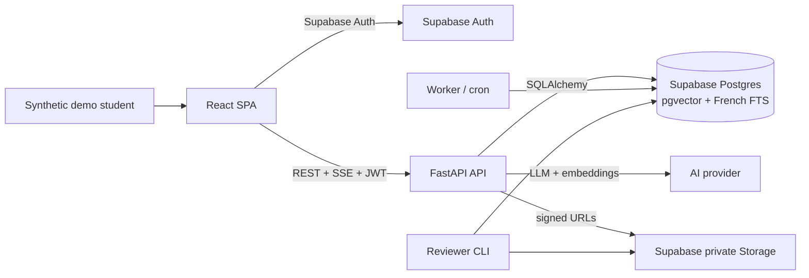

# AI Mathematics Tutor — Implementation Plan (v0.1.0 Academic Demo)

## Document control

| Field | Value |
| --- | --- |
| Product | AI Mathematics Tutor — Moroccan Tronc Commun Scientifique (TCS), Option Française |
| Release | `v0.1.0` academic demo |
| Status | Conditionally approved — pending Week-2 go/no-go and the written pilot waiver |
| Version | 1.1 |
| Date | 24 November 2026 |
| Team | 3 developers, 25–30 hours/week each, 16-week horizon |
| Source of truth | `docs/implementation-plan.md` |
| Supersedes | `backend_implementation_plan.md` (desktop draft); the deleted `docs/architecture.md`; any 2BAC or two-track interpretation of `PFE_Detailed_Execution_Plan.pdf` |
| Reviewers | Academic supervisor; Mathematics reviewer (2–3 hours/week, confirmed) |
| Pilot | Out of scope for `v0.1.0`; written supervisor waiver for the client-brief pilot criterion |

> This plan is the single authoritative plan for the project. If another document conflicts with it, this document wins. The old SEC-filing architecture and download script are stale and must be removed or replaced during Week 1.

---

## 1. Executive summary

The project is a browser-based, French-first mathematics tutor for Moroccan **Tronc Commun Scientifique** students. It answers questions strictly from three reviewed chapters of **MAXI Maths — Tronc Commun Scientifique**, refuses when evidence is insufficient, and validates every teaching step before it reaches the student.

This release is an **academic demo**, not a production pilot. It uses synthetic student profiles, no real student data, and trial AI credits. It is designed to demonstrate the complete controlled teaching loop:

1. Authenticate and select an approved chapter.
2. Ask by text or push-to-talk French audio.
3. Optionally upload an exercise photo and confirm ambiguous symbols.
4. Retrieve approved textbook evidence.
5. Generate a short structured teaching step.
6. Validate it through four gates.
7. Present it as text, board actions, and French speech.
8. Save, resume, practice, and plan.

The demo must prove **control and provenance**, not unlimited tutoring. The system must never fall back to an ungrounded answer.

### Definition of done

The academic demo is done when:

- 10/10 scripted end-to-end journeys complete, save, and reload.
- 20/20 interruption tests reject stale events and stop local audio in under 500 ms.
- At least 90% of in-scope evaluation tasks are fully correct and scoped.
- 0 unsupported releases across the boundary set (out-of-scope, missing evidence, prompt injection).
- 100% of released steps cite valid published source IDs and page references.
- All cross-user access attempts are denied.
- The demo runs within available trial credits, with a recorded fallback.
- The tagged release, report, demo script, and known-issues list are delivered.

---

## 2. Scope contract

### 2.1 Product level

- **Level:** Tronc Commun Scientifique (TCS) only.
- **Track:** one track. No Sciences Physiques / Sciences Mathématiques split.
- **Language:** French-first teaching. Arabic, Darija, and English are not teaching languages in this release.
- **Audience:** synthetic demo profiles. No real students, no minors' data, no consent collection in this release.

### 2.2 Approved chapters

Exactly three chapters from **MAXI Maths — Tronc Commun Scientifique**:

1. **Les ensembles de nombres**
2. **Calcul vectoriel**
3. **Généralités sur les fonctions**

Chapter IDs, objective IDs, page ranges, and the coverage matrix must be confirmed by the Mathematics reviewer before corpus publication.

### 2.3 Interaction modes

| Mode | In scope | Notes |
| --- | --- | --- |
| Text chat | Yes | Primary interaction; French-first |
| Push-to-talk French audio | Yes | STT → controlled teaching → TTS; no continuous listening |
| Exercise photo upload | Yes | Preview, OCR/symbol extraction, ambiguity confirmation |
| Shared whiteboard | Yes | Excalidraw + KaTeX; validated board actions; board-before-speech sync |
| Continuous listening | No | Explicitly out of scope |
| Student handwriting recognition | No | Only photo upload with symbol confirmation |
| Native mobile app | No | Browser only |

### 2.4 Out of scope

- 1BAC, 2BAC, Collège, or university content.
- Full MAXI Maths textbook ingestion.
- Two-track support.
- Simultaneous Arabic/Darija/French teaching.
- Payments, subscriptions, social features, marketplaces.
- Custom model training, microservices, multi-agent orchestration.
- Arbitrary mathematical proof verification.
- Production-scale availability, uptime SLAs, or zero-hallucination claims.
- Real student pilot, guardian consent, CNDP filing, or institutional data collection. Deferred by D-21; the client-brief pilot criterion is waived in writing for `v0.1.0`.
- Public distribution of MAXI Maths source files or full chunk text.

### 2.5 Reduction ladder

If the 16-week schedule slips, reduce in this order. Never weaken authorization, provenance, scope control, or validation.

1. Continuous listening — **already out of scope**.
2. Simplify diagrams and board actions.
3. Reduce planning to availability + simple tasks.
4. Reduce exercise breadth to MCQ + numeric tolerance.
5. Reduce photo conditions and ambiguity handling.
6. Drop push-to-talk **last**.

### 2.6 Success criteria

| Area | Target |
| --- | --- |
| End-to-end demo | 10/10 scripted journeys complete, save, reload |
| Interruption | 20/20 stale events rejected; local audio stop < 500 ms |
| In-scope correctness | ≥ 90% fully correct and scoped on reviewer-approved tasks |
| Boundary behavior | 0 unsupported releases on out-of-scope, missing-evidence, and injection cases |
| Provenance | 100% of released steps cite valid published source IDs/pages |
| Access control | 100% of cross-user record/file attempts denied |
| Cost | Within available trial credits; hard stop and fallback defined |
| Latency | Best effort: p50 ≤ 5 s, p95 ≤ 12 s to first accepted output on the demo machine |
| Documentation | Plan, architecture, contracts, evaluation, runbooks, demo script, known issues |

---

## 3. Locked decisions

| ID | Decision | Rationale / consequence |
| --- | --- | --- |
| D-01 | TCS, one track | Matches `AGENTS.md`, client brief, and the approved scope |
| D-02 | Single project plan at `docs/implementation-plan.md` | One source of truth for scope, backend, frontend, demo, and delivery |
| D-03 | 16-week full `v0.1.0` academic demo | Includes text, push-to-talk, photos, board, practice, planning |
| D-04 | Three chapters: client-brief trio | Les ensembles de nombres; Calcul vectoriel; Généralités sur les fonctions |
| D-05 | Continuous listening out; push-to-talk stays | Matches the client-brief baseline and the reduction ladder |
| D-06 | Four gates: Source, Scope, Grounding, Mathematical & Rendering Safety | Matches `AGENTS.md` and the client brief; removes the plan's structural-only gate |
| D-07 | SymPy CAS + rubric verifier | Deterministic checks for computable claims; LLM rubric only as supporting evidence |
| D-08 | Claim-level citations; deterministic quote match first | Prevents parallel-list drift and fabricated citations |
| D-09 | Objective coverage matrix + concept taxonomy | Replaces brittle keyword blacklists |
| D-10 | Reviewer confirmed at 2–3 h/week; corpus first, then evaluation | Realistic sequencing; evaluation follows stable corpus |
| D-11 | CLI-only publication for v0.1.0 | No admin upload API or file-handling attack surface |
| D-12 | Hybrid extraction + reviewer correction | PDF text layer; vision only for equations/figures; reviewer signs off |
| D-13 | Academic-use assumption for MAXI Maths | Local-only corpus, no public distribution, short quotes only |
| D-14 | FORCE RLS + non-owner app role; service role only in admin/ingest | True application + database authorization |
| D-15 | SSE with AI SDK-compatible parts; final validated message only | No unvalidated token streaming; fits `useChat` transport |
| D-16 | Trial credits only; no per-student cap | Global credit ledger, per-turn cap, hard stop, recorded fallback |
| D-17 | Developer A owns frontend/classroom; Playwright added | Clear ownership and executable acceptance evidence |
| D-18 | `frontend/AGENTS.md` amended for Playwright | Plan and repo policy must not conflict |
| D-19 | Local demo + optional free-tier deployment; recorded fallback | No paid hosting budget; p95 is best-effort |
| D-20 | Use PDF scope-reduction order after voice | Simplify diagrams, planning, exercise breadth, photo conditions |
| D-21 | Academic demo only; client-brief pilot deferred | Written supervisor waiver; synthetic profiles; no consent/CNDP work in `v0.1.0` |
| D-22 | Direct SQLAlchemy runtime + per-request JWT claims GUC; PostgREST denies internal tables | Makes `FORCE RLS` real; no service-role in API; explicit grants |
| D-23 | Dedicated media, speech, and board endpoints + tables | Photo/voice/board are in scope; signed uploads, STT/TTS, snapshots |
| D-24 | `teaching_claims` is first-class; citations reference stored claims | Auditable claim-level provenance and Gate 2 objective mapping |
| D-25 | Structured math contract + SymPy; refuse when unverifiable | Variables, domain, assumptions, expected form; no bare `math_expression` |
| D-26 | 20 in-scope + 20 boundary evaluation tasks | Fits reviewer capacity; directional evidence, not statistical proof |
| D-27 | Hosted app DB with private chunks; no public distribution | Private Supabase, PostgREST deny rules, supervisor rights note |
| D-28 | API never holds the service-role key; split admin/ingest settings | Service role only in CLI/ingest; API starts without it |
| D-29 | Role source is JWT `app_metadata.role` | No self-escalation; `profiles.role` is display-only or removed |

---

## 4. Architecture

### 4.1 System context



### 4.2 Services

| Service | Responsibility |
| --- | --- |
| Frontend SPA | Auth state, classroom UI, chat/SSE, citations, board, media, practice, planning |
| FastAPI API | Auth, scope resolution, retrieval, agent orchestration, four gates, persistence, SSE |
| Worker / cron | Stuck-turn recovery, budget reconciliation, cleanup, optional evaluation jobs |
| Supabase Auth | Email-only identity for synthetic demo users |
| Supabase Postgres | Profiles, curriculum, revisions, chunks, sessions, turns, citations, practice, plans, usage |
| Supabase Storage | Private source assets, student media (demo only) |
| AI provider | LLM, embeddings, vision/OCR, STT, TTS behind server-side adapters |
| Reviewer CLI | Local extraction, review, publication, withdrawal, embedding |

### 4.3 Backend module layout

```text
backend/
├── alembic/
├── app/
│   ├── main.py
│   ├── config.py
│   ├── api/
│   │   ├── router.py
│   │   ├── auth.py
│   │   ├── curriculum.py
│   │   ├── sessions.py
│   │   ├── turns.py
│   │   ├── practice.py
│   │   ├── planning.py
│   │   └── health.py
│   ├── auth/
│   │   └── dependencies.py
│   ├── core/
│   │   ├── logging.py
│   │   ├── errors.py
│   │   └── middleware.py
│   ├── classroom/
│   │   ├── engine.py
│   │   ├── streaming.py
│   │   ├── idempotency.py
│   │   └── board_validator.py
│   ├── assistant/
│   │   ├── agent.py
│   │   ├── deps.py
│   │   ├── contracts.py
│   │   ├── prompts.py
│   │   └── instructions.md
│   ├── retrieval/
│   │   ├── queries.py
│   │   ├── fusion.py
│   │   └── retriever.py
│   ├── validation/
│   │   ├── source_gate.py
│   │   ├── scope_gate.py
│   │   ├── grounding_gate.py
│   │   ├── math_gate.py
│   │   ├── render_gate.py
│   │   ├── refusal.py
│   │   └── pipeline.py
│   ├── practice/
│   │   ├── evaluator.py
│   │   └── schemas.py
│   ├── planning/
│   │   └── generator.py
│   ├── providers/
│   │   ├── llm.py
│   │   ├── embeddings.py
│   │   ├── vision.py
│   │   └── speech.py
│   ├── budget/
│   │   ├── reservation.py
│   │   └── reconciliation.py
│   ├── jobs/
│   │   ├── runner.py
│   │   └── handlers.py
│   └── database/
│       ├── session.py
│       ├── models/
│       └── repositories/
├── ingest/
│   ├── extract.py
│   ├── normalizer.py
│   ├── chunker.py
│   ├── pipeline.py
│   ├── review_cli.py
│   └── publish_cli.py
├── tests/
└── pyproject.toml
```

### 4.4 Trust boundaries

- **Browser:** untrusted. Holds only the Supabase anon key and user JWT. Never holds service-role or provider keys.
- **FastAPI:** authoritative. Resolves identity, track, chapter, objective, curriculum version, retrieval, validation, and persistence.
- **AI provider:** untrusted output. Never authorized to choose scope, roles, chapter, or database actions.
- **Retrieved content:** untrusted data. Delimited and treated as evidence, never as instructions.
- **Reviewer CLI:** privileged local tool. Uses the service-role key; never exposed to the SPA.
- **Supabase:** identity and durable state. RLS is enforced for the runtime role; service role is restricted to admin/ingest paths.

---

## 5. Data model

### 5.1 Tables

| Table | Purpose | Key fields / constraints |
| --- | --- | --- |
| `profiles` | Demo users | `id` → `auth.users.id`; `email`; `display_name`; `role` (`student`/`reviewer`/`admin`); `academic_track='TCS'`; `is_synthetic`; timestamps |
| `curriculum_chapters` | Three approved chapters | `id` (stable slug); `chapter_number`; `title_fr`; `status` (`draft`/`reviewed`/`published`/`withdrawn`) |
| `curriculum_objectives` | Objective-level scope | `id`; `chapter_id`; `code`; `title_fr`; `concept_tags` (`JSONB`); `order_index` |
| `objective_prerequisites` | Prerequisite graph | `objective_id`; `prerequisite_id`; both FKs; cycle check in app/CI |
| `source_documents` | Source identity | `id`; `title`; `publisher`; `edition_year`; `provenance_notes`; `academic_use_basis`; `rights_status` |
| `source_revisions` | Immutable chapter revisions | `id`; `source_document_id`; `chapter_id`; `revision_number`; `content_hash`; `reviewer_id`; `status`; `reviewed_at`; `published_at`; `supersedes_revision_id`; `withdrawn_at`; `withdrawal_reason` |
| `document_chunks` | Retrieval units | `id`; `revision_id`; `chapter_id`; `chunk_index`; `section_path`; `page_start`; `page_end`; `char_start`; `char_end`; `content_type`; `chunk_text`; `search_text`; `content_hash`; `token_count`; `embedding` `vector(1536)`; `status` |
| `chunk_objectives` | Chunk ↔ objective | `chunk_id`; `objective_id`; both FKs |
| `tutoring_sessions` | Conversation scope | `id`; `student_id`; `chapter_id`; `objective_id` (nullable current focus); `curriculum_revision_id`; `title`; `status` (`active`/`archived`/`deleted`); `turn_count` |
| `session_turns` | One student turn | `id`; `session_id`; `turn_index`; `student_prompt`; `response_status` (`pending`/`processing`/`completed`/`failed`/`cancelled`); `educational_status`; `refusal_code`; `message_fr`; `final_payload` (`JSONB`); `model_name`; `prompt_version`; `retrieval_config`; `token_counts`; `latency_ms`; `validation_metadata` (`JSONB`); `created_at`; `processing_started_at`; `expires_at`; `locked_by` |
| `teaching_steps` | Validated output units | `id`; `turn_id`; `step_index`; `display_text_fr`; `spoken_text_fr`; `board_actions` (`JSONB`); `next_action`; `validation_status` |
| `turn_citations` | Claim ↔ source | `id`; `turn_id`; `step_id`; `teaching_claim_id` (FK); `chunk_id`; `revision_id`; `content_hash`; `page_number`; `section_reference`; `quote_excerpt`; `quote_start`; `quote_end` |
| `exercises` | Reviewed exercise bank | `id`; `chapter_id`; `objective_id`; `code`; `source_reference`; `exercise_type` (`mcq`/`numeric_tolerance`/`algebraic_expression`/`guided_multistep`); `answer_schema` (`JSONB`); `hints_fr` (`JSONB`); `difficulty_level`; `status` |
| `exercise_revisions` | Immutable exercise versions | `id`; `exercise_id`; `revision_number`; `problem_statement_fr`; `answer_schema`; `reviewer_id`; `review_status`; `change_summary` |
| `exercise_attempts` | Student attempts | `id`; `student_id`; `exercise_id`; `exercise_revision_id`; `session_id`; `submitted_answer` (`JSONB`); `evaluation_result` (`correct`/`incorrect`/`inconclusive`); `error_category`; `evaluation_details` (`JSONB`); `feedback_fr`; `hints_requested` |
| `hint_events` | Hint usage | `id`; `attempt_id`; `hint_index`; `requested_at` |
| `study_plans` | One active plan per student | `id`; `student_id`; `target_weekly_hours`; `timezone`; `is_active`; `version`; partial unique `(student_id) WHERE is_active` |
| `availability_windows` | Study windows | `id`; `plan_id`; `day_of_week` (1–7); `start_time`; `end_time`; check `start < end` |
| `study_tasks` | Scheduled tasks | `id`; `plan_id`; `objective_id`; `title_fr`; `scheduled_date`; `allocated_minutes`; `status` (`pending`/`completed`/`skipped`); `completed_at`; `order_index` |
| `budget_reservations` | Pre-turn credit holds | `id`; `turn_id`; `student_id`; `reserved_usd`; `actual_usd`; `status` (`reserved`/`reconciled`/`released`); `expires_at`; unique active reservation per turn |
| `usage_events` | Actual provider usage | `id`; `source` (`turn`/`ingestion`); `turn_id` (nullable); `student_id` (nullable); `model_name`; `input_tokens`; `output_tokens`; `cached_tokens`; `embedding_tokens`; `price_version`; `total_cost_usd`; `provider_request_id`; `created_at` |
| `jobs` | Background work | `id`; `job_type`; `payload`; `status`; `run_after`; `attempts`; `locked_at`; `locked_by` |
| `audit_events` | Administrative/security trail | `id`; `actor_id`; `action`; `entity_type`; `entity_id`; `payload` (`JSONB`); `created_at` |
| `teaching_claims` | Persisted claim-level provenance | `id`; `turn_id`; `step_id`; `claim_id`; `claim_text_fr`; `claim_span_start`; `claim_span_end`; `objective_id`; `math_claim` (`JSONB`); `validation_status` |
| `media_assets` | Photo/audio upload metadata | `id`; `student_id`; `session_id`; `turn_id` (nullable); `kind`; `storage_path`; `mime_type`; `byte_size`; `content_hash`; `status`; `created_at`; `expires_at` |
| `board_snapshots` | Persisted board revisions | `id`; `session_id`; `turn_id`; `revision`; `state` (`JSONB`); `created_at`; unique `(session_id, revision)` |
| `turn_idempotency` | TTL idempotency keys | `id`; `session_id`; `idempotency_key`; `request_hash`; `turn_id`; `expires_at`; unique `(session_id, idempotency_key)` |
| `budget_ledger` | Single global credit row | `id` (singleton); `budget_usd`; `reserved_usd`; `spent_usd`; `version`; `updated_at` |
| `rate_limit_counters` | Postgres-backed rate limiting | `id`; `scope` (`user`/`ip`); `subject_id`; `window_start`; `count`; `expires_at` |

`usage_events` carries `source` (`turn`/`ingestion`) and nullable `turn_id`/`student_id`; `turn_citations` references `teaching_claim_id`. See §22.2 for the normative schema and constraints.

### 5.2 Invariants

- `session_turns` has unique `(session_id, turn_index)`; `turn_idempotency` has unique `(session_id, idempotency_key)` and expires without deleting turn history.
- `teaching_claims` has unique `(turn_id, claim_id)`; every `turn_citations.teaching_claim_id` references a claim on the same turn.
- Refusals are `completed` turns and persist `refusal_code`, `message_fr`, and `final_payload`; they are reloadable.
- A turn's `educational_status` is independent of `response_status`. A refusal is a completed turn, not a failure.
- `teaching_steps` and `turn_citations` are immutable after `completed`; corrections create a new turn.
- `source_revisions` content is immutable after publication. Status transitions are append-only.
- Citations pin `revision_id` and `content_hash`, not a mutable chunk row.
- `document_chunks.status` is derived from its revision; only `published` revisions participate in retrieval.
- Exercise attempts pin `exercise_revision_id`.
- One active `study_plan` per student; completed tasks survive plan regeneration.
- One active `budget_reservation` per turn. Reservation and reconciliation lock the singleton `budget_ledger` row with `FOR UPDATE` so totals are atomic with the cap check.
- `usage_events.source` distinguishes turn usage from ingestion embeddings; ingestion rows have null `turn_id`/`student_id`.
- `jobs` are claimed with `FOR UPDATE SKIP LOCKED`; handlers are idempotent.

### 5.3 Indexes and RLS

- B-tree indexes on `student_id`, `session_id`, `chapter_id`, `status`, `created_at`, `(session_id, turn_index)`.
- HNSW index on `document_chunks.embedding` with `vector_cosine_ops`.
- GIN index on `document_chunks.search_vector`.
- GIN/JSONB indexes on `concept_tags`, `board_actions`, and validation metadata where queried.
- Enable and `FORCE ROW LEVEL SECURITY` on every table in the `public` schema; deny by default.
- `app_runtime` is a non-owner runtime role. Per transaction, the API sets `request.jwt.claims` from the verified JWT and `SET LOCAL ROLE authenticated` before queries; `auth.uid()` is otherwise null.
- Grant `app_runtime` usage on the `auth` schema and execute on `auth.uid()`, or use `current_setting('request.jwt.claims', true)` policies.
- Revoke direct `anon`/`authenticated` access to internal tables; `document_chunks.chunk_text`, `exercises.answer_schema`, and `profiles.role` are not directly readable by students. FastAPI is the only student data path.
- Policies use `auth.uid()`/JWT claims and explicit role checks; `profiles.role` is not an authorization input.
- The service role is loaded only by `AdminSettings` in CLI/ingest and is excluded from the API process.

---

## 6. Identity and authorization

### 6.1 Authentication

- Supabase Auth, email-only, synthetic demo accounts.
- Frontend stores the session through `@supabase/supabase-js`.
- Every API request carries `Authorization: Bearer <supabase_access_token>`.
- FastAPI verifies the JWT through Supabase JWKS:
  - issuer: project URL + `/auth/v1`
  - audience: `authenticated`
  - signature, expiry, `kid` rotation, clock skew
  - cached keys with refresh
- Derive `user_id` and role from verified JWT claims (`sub`, `app_metadata.role`). `profiles.role` is a display mirror only and never an authorization input.

### 6.2 Roles

| Role | Permissions |
| --- | --- |
| `student` | Own sessions, turns, attempts, plans; read published curriculum |
| `reviewer` | Read drafts; run local review/publish CLI; no student data |
| `admin` | Manage users, budgets, audit; no direct student impersonation |
| `system` | Worker/jobs; scoped service operations |

### 6.3 Authorization matrix

| Resource | Student | Reviewer | Admin | System |
| --- | --- | --- | --- | --- |
| Own profile | Read/update (role immutable) | — | Read | Read |
| Other profiles | Deny | Deny | Read | Read |
| Published curriculum | Read | Read | Read | Read |
| Draft sources/chunks | Deny | Read (local CLI) | Read | Read |
| Own sessions/turns | Read; create via API only | Deny | Deny | Read/recover |
| Other sessions/turns | Deny | Deny | Deny | Read/recover |
| Exercises | Read published | Review/publish | Read | Read |
| Own attempts | Create/read | Deny | Deny | Read |
| Own study plan | Read/update | Deny | Deny | Read |
| Usage/budget | Own summary | Deny | Read | Read/write |
| Audit events | Deny | Deny | Read | Write |

### 6.4 Service-role isolation

- `SUPABASE_SERVICE_ROLE_KEY` is loaded only by `AdminSettings` in `app/database/admin.py` and `ingest/`; it is not part of the API settings and the API process must start without it.
- Student request handlers import only the runtime engine.
- A CI import test fails if `app.main`, `app/api`, or any request-path module imports `AdminSettings` or the admin client.
- Admin HTTP routes are not exposed in `v0.1.0`; publication is CLI-only.

### 6.5 Rate limits and abuse controls

- Max prompt length: 4,000 characters.
- Max concurrent turns per user: 1.
- Max turns per minute per user: 6.
- Max turns per session: 30.
- Max photo size: 10 MB; MIME allowlist; re-encode and strip metadata.
- Rate-limit state stored in Postgres for multi-instance safety; single-instance demo may use a process-local fallback with a documented limitation.

---

## 7. API and event contracts

### 7.1 REST endpoints

| Method | Path | Purpose |
| --- | --- | --- |
| `GET` | `/health` | Liveness |
| `GET` | `/ready` | DB/provider readiness |
| `GET` | `/api/v1/me` | Current synthetic profile |
| `PATCH` | `/api/v1/me` | Display name, preferences |
| `GET` | `/api/v1/curriculum/chapters` | Published chapters |
| `GET` | `/api/v1/curriculum/chapters/{id}/objectives` | Published objectives |
| `POST` | `/api/v1/sessions` | Create session |
| `GET` | `/api/v1/sessions` | List own sessions (cursor pagination) |
| `GET` | `/api/v1/sessions/{id}` | Session + validated history |
| `PATCH` | `/api/v1/sessions/{id}` | Rename/archive |
| `DELETE` | `/api/v1/sessions/{id}` | Soft delete |
| `POST` | `/api/v1/sessions/{id}/turns` | Submit a turn; SSE response; requires `Idempotency-Key` |
| `POST` | `/api/v1/sessions/{id}/interrupt` | Cancel active turn |
| `GET` | `/api/v1/sessions/{id}/turns` | Turn history (cursor pagination) |
| `GET` | `/api/v1/exercises` | Published exercise list |
| `POST` | `/api/v1/exercises/{id}/attempts` | Submit attempt |
| `GET` | `/api/v1/progress` | Attempt history and revision indicators |
| `GET` | `/api/v1/study-plan` | Active plan |
| `PUT` | `/api/v1/study-plan` | Create/replace plan |
| `PATCH` | `/api/v1/study-tasks/{id}` | Complete/skip task |
| `POST` | `/api/v1/sessions/{id}/media` | Create a signed photo upload / register media asset |
| `POST` | `/api/v1/media/{id}/interpret` | OCR/symbol extraction; return ambiguity candidates |
| `POST` | `/api/v1/media/{id}/confirm` | Store the confirmed expression or reject the asset |
| `POST` | `/api/v1/speech/transcribe` | Push-to-talk French audio → editable transcript |
| `POST` | `/api/v1/speech/synthesize` | Validated French text → TTS audio URL/stream |
| `GET` | `/api/v1/sessions/{id}/board` | Current board revision + snapshot |
| `GET` | `/api/v1/sessions/{id}/board/revisions/{revision}` | Historical board snapshot |
| `GET` | `/api/v1/exercises/{id}` | Exercise detail without answer schema |
| `POST` | `/api/v1/exercises/{id}/hints` | Next approved hint |

### 7.2 SSE contract

`POST /api/v1/sessions/{id}/turns` returns `text/event-stream`.

- Use the installed AI SDK's UI message stream protocol.
- Emit status/metadata as data parts; emit the final validated answer as a single text part (or one `text-delta` containing the full validated text).
- Never emit raw model tokens before validation.
- Event sequence:

```text
turn.started
retrieval.completed       { chunkIds, scores }
validation.started
validation.completed      { gates, educationalStatus }
board.updated             { revision, actions }
message.final             { text, citations, boardActions, boardRevision, spokenText }
turn.completed
speech.ready              { audioUrl, expiresAt }
```

- On failure:

```text
turn.failed { code, educationalStatus, messageFr, retryable }
```

- On idempotent replay, emit the stored final message; do not re-run the model.
- On credit exhaustion, emit `CREDIT_EXHAUSTED`; do not emit text.
- On client abort, the server marks the turn `cancelled` when detected and releases the reservation.

### 7.3 Turn response payload

```json
{
  "turnId": "uuid",
  "status": "completed",
  "educationalStatus": "accepted",
  "refusalCode": null,
  "messageFr": "...",
  "citations": [
    {
      "claimId": "c1",
      "chunkId": "uuid",
      "revisionId": "uuid",
      "page": 42,
      "section": "Définition",
      "quote": "short excerpt"
    }
  ],
  "boardActions": [],
  "boardRevision": 3,
  "spokenTextFr": "...",
  "nextActions": [],
  "usage": { "inputTokens": 0, "outputTokens": 0, "costUsd": 0.0 }
}
```

### 7.4 Status mapping

| Outcome | `response_status` | `educational_status` |
| --- | --- | --- |
| Validated answer | `completed` | `accepted` |
| Out-of-scope question | `completed` | `outside_scope` |
| Missing evidence | `completed` | `insufficient_evidence` |
| Ambiguous question | `completed` | `clarification_required` |
| Math/render gate refusal | `completed` | `validation_failed` |
| Provider/infra failure | `failed` | `provider_unavailable` |
| Credits exhausted | `failed` | `credit_exhausted` |
| Timeout / client abort | `cancelled` | `cancelled` |

### 7.5 Idempotency

- `Idempotency-Key` is required and must be a UUID.
- Unique `(session_id, idempotency_key)` in `turn_idempotency`, not `session_turns`.
- `request_hash` covers prompt, chapter, objective, options, `mediaAssetId`, and `confirmedExpression`.
- Same key + same hash + `completed` → replay stored response.
- Same key + different hash → `409 Conflict`.
- Same key + `processing` → `409 Conflict` (or `202` with status endpoint, if added).
- Same key + `failed` → allow retry only for retryable errors; otherwise return the failure.
- Keys expire after 24 hours; cleanup removes only `turn_idempotency` rows, never turn history.

### 7.6 Errors and pagination

- `400` malformed input; `401` missing/invalid token; `403` forbidden; `404` not found; `409` idempotency conflict; `422` validation error; `429` rate/quota; `502/503` provider; `504` timeout.
- Error body: `{ "code": "...", "messageFr": "...", "requestId": "..." }`.
- Cursor pagination: `?limit=20&cursor=<opaque>`; stable ordering by `created_at, id`.
- Every response carries `X-Request-ID`; logs correlate request, session, and turn IDs.

---

## 8. Teaching pipeline and validation

### 8.1 Pipeline

```text
Authenticate
  → resolve session, chapter, objective, curriculum revision
  → pre-scope check
  → hybrid retrieval
  → evidence sufficiency check
  → PydanticAI draft (claims + steps + board actions)
  → Gate 1: Source validity
  → Gate 2: Scope validity
  → Gate 3: Grounding
  → Gate 4: Mathematical & Rendering Safety
  → persist validated steps/citations
  → emit SSE final message
  → reconcile usage/credits
```

### 8.2 Draft output contract

```python
class MathClaim(BaseModel):
    expression_latex: str
    variables: dict[str, str] = {}
    assumptions: list[str] = []
    expected_form: str | None = None
    check: Literal["simplify", "solve", "interval", "vector", "property"]

class BoardAction(BaseModel):
    action_id: str
    object_id: str
    author: Literal["tutor", "student"]
    op: Literal[
        "add_text", "add_equation", "add_line", "add_arrow",
        "add_shape", "highlight", "update", "remove",
    ]
    payload: dict[str, Any]
    revision: int

class CitationDraft(BaseModel):
    claim_id: str
    chunk_id: UUID
    revision_id: UUID
    quote: str
    page_number: int
    section: str | None = None

class ClaimDraft(BaseModel):
    claim_id: str
    objective_id: str
    text_fr: str
    claim_span_start: int
    claim_span_end: int
    citations: list[CitationDraft] = []
    math: MathClaim | None = None

class TeachingStepDraft(BaseModel):
    step_id: str
    display_text_fr: str
    spoken_text_fr: str
    claims: list[ClaimDraft]
    board_actions: list[BoardAction] = []
    next_actions: list[str] = []

class AgentDraftOutput(BaseModel):
    steps: list[TeachingStepDraft]
    suggested_status: str  # diagnostic only; never authoritative
```

- The server ignores `suggested_status` for release decisions.
- A turn is all-or-nothing in `v0.1.0`: if any step fails a gate, the turn is refused or clarified.
- Parallel `cited_chunk_ids` / `quoted_excerpts` lists are prohibited.
- Every claim carries `objective_id`; connective text outside claim spans is allowed and does not require a citation.
- `citations` is a list; one or more per claim. Each citation is resolved server-side to a `teaching_claim_id` on the same turn.
- `math` is required for computation claims and absent for pure prose; Gate 4 uses its variables, assumptions, expected form, and check type.
- `BoardAction.revision` is monotonic per session; stale revisions are rejected. See §22.5.

### 8.3 Gate 1 — Source validity

Deterministic checks:

- Every `chunk_id` exists.
- The chunk belongs to the cited `revision_id`.
- The revision is `published` and not withdrawn at validation time.
- The chunk's `content_hash` matches the citation.
- The quote is present in the chunk after normalization.
- The page/section metadata matches the chunk.
- The quote length is within the academic-use limit.

Failure → `validation_failed` or `insufficient_evidence`; never a silent citation substitution.

### 8.4 Gate 2 — Scope validity

- The session's chapter and objective are approved and published.
- Every claim carries `objective_id`; each `objective_id` must be an approved objective in the coverage matrix, and every cited chunk must be mapped to that objective (or an approved prerequisite) in `chunk_objectives`.
- Concept tags are allowed for the active objective.
- Prerequisite concepts are allowed only through the reviewed prerequisite graph.
- Cross-chapter citations are allowed only for approved prerequisites.
- A pre-retrieval classifier blocks obvious 1BAC/2BAC questions before spending credits.
- Keyword detection (derivatives, integrals, limits, complex numbers) is a secondary signal only; the objective matrix is authoritative.

Failure → `outside_scope` with a specific refusal code.

### 8.5 Gate 3 — Grounding

1. Deterministic quote match:
   - Unicode NFKC, casefold, accent folding, whitespace collapse, hyphenation handling.
   - Exact match preferred; fuzzy match above a calibrated threshold otherwise.
   - Store `quote_start` / `quote_end`.
2. Claim coverage:
   - Every claim must have at least one valid citation.
   - At least one citation must support the claim's main assertion, not just a keyword.
3. Optional entailment judge:
   - Fixed model/version, temperature 0, prompt version recorded.
   - Runs only if deterministic checks pass but the claim is paraphrased.
   - Treated as supporting evidence, not proof.
   - If unavailable or contradictory, fail closed to `insufficient_evidence`.
4. No threshold on the RRF score. Use raw cosine similarity, lexical coverage, and claim-level evidence.

### 8.6 Gate 4 — Mathematical & Rendering Safety

**Math correctness**

- Claims are classified as:
  - definition/theorem/method → must match a reviewed source and method template;
  - computation → SymPy check where possible;
  - strategy/explanation → rubric verifier + reviewer sampling.
- SymPy checks:
  - arithmetic, simplification, equation solving, interval/set operations, vector calculations, function properties.
  - Use `sympy.simplify(expr1 - expr2) == 0` with explicit assumptions; reject when assumptions are missing.
  - Parse from the structured `MathClaim` (expression, variables, assumptions, expected form), never from free text; run in a sandbox with a short timeout and a banned-function allowlist.
- Rubric verifier:
  - Fixed prompt, fixed model/version, temperature 0.
  - Scores correctness, scope, notation, and age-appropriateness.
  - A low score or disagreement blocks release.
- Unverifiable claims → `MATH_UNVERIFIABLE` refusal/clarification, never release.
- A deliberately corrupted "wrong-answer" test set measures gate recall.

**Rendering safety**

- KaTeX subset allowlist; no raw HTML, `\htmlClass`, `\href`, or unsafe commands.
- Balanced delimiters and supported commands; parser/allowlist, not regex-only.
- Max display text length and max math expression length.
- Board actions:
  - allowlist: add text, add equation, line/arrow, supported shapes, highlight, update/remove by ID;
  - coordinate bounds (`[-10000, 10000]`), object count (≤ 200), text lengths (≤ 2000 chars);
  - student objects vs tutor objects (via `BoardAction.author`);
  - `revision` must be strictly increasing per session; stale actions are rejected;
  - no arbitrary scripts or URLs.
- If the board cannot apply an action, do not narrate it as if visible.

### 8.7 Refusal and clarification

| Code | Meaning | Student-visible behavior |
| --- | --- | --- |
| `OUT_OF_SCOPE_LEVEL` | 1BAC/2BAC/university topic | Explain the current release scope; suggest an approved chapter |
| `OUT_OF_SCOPE_CHAPTER` | Approved level, unapproved chapter | Explain supported chapters |
| `INSUFFICIENT_EVIDENCE` | No adequate approved evidence | Say the approved material does not support an answer |
| `AMBIGUOUS_QUESTION` | Symbol/expression unclear | Ask a focused clarification question |
| `MATH_UNVERIFIABLE` | Cannot verify the computation | Ask for clarification or refuse |
| `MATH_INCORRECT` | Draft contradicts CAS/rubric | Refuse; log for review |
| `RENDERING_UNSAFE` | Invalid/unsafe math or board action | Refuse; log |
| `SOURCE_WITHDRAWN` | Pinned source revision was withdrawn | Keep history read-only; suggest a new session or a replacement revision |
| `PROVIDER_UNAVAILABLE` | Provider failure | Explain temporary unavailability; preserve session |
| `CREDIT_EXHAUSTED` | Trial credits exhausted | Explain demo limitation; show fallback |
| `RATE_LIMITED` | Too many requests | Ask the student to wait |
| `TURN_LIMIT_REACHED` | Session limit | Suggest a new session |

Templates are French, reviewer-approved, versioned, and stable-coded. The model never writes refusal text directly.

### 8.8 Prompt and model versioning

Every turn stores:

- `model_name` and provider version;
- `prompt_version`;
- `curriculum_revision_id`;
- retrieval parameters (`top_k`, `rrf_k`, thresholds);
- validation gate versions;
- judge model/prompt version, if used.

Prompts live in `assistant/prompts.py` and `assistant/instructions.md` with explicit version constants. A prompt change requires regression evaluation.

---

## 9. Corpus ingestion and review

### 9.1 Academic-use assumption

MAXI Maths is a published commercial textbook. This release is an academic demo, not a public distribution.

Recorded assumption:

- No public distribution of the source PDFs or full extracted text.
- Raw PDFs, scans, and extracts remain local and gitignored under `data/`.
- The demo UI shows only short citations/excerpts (≤ 25 words or ≤ 300 characters per citation).
- No API returns full `chunk_text` to student clients; direct `anon`/`authenticated` (PostgREST) reads of `document_chunks.chunk_text` and `exercises.answer_schema` are revoked.
- The corpus is private-hosted, not local-only: reviewed `document_chunks` live in a private Supabase Postgres project, while raw files stay local. The team lead records the academic-use note and the supervisor acknowledges it by Week 2 before publication.
- Generated `display_text_fr` must not reproduce long verbatim textbook passages; a quote-length check applies to model output as well as citations.
- This is an assumption, not a legal conclusion. If the project later becomes public or commercial, rights review is required before publication.

### 9.2 Input contract

Each chapter is imported as a manifest plus structured units:

```json
{
  "chapter_id": "tcs_math_ch01_ensembles",
  "source_document": "maxi_maths_tcs",
  "edition_year": 2024,
  "page": 42,
  "section_path": ["Chapitre 1", "1.2 Ensembles de nombres", "Définition"],
  "content_type": "definition",
  "text_md": "...",
  "math_expressions": ["\\mathbb{N} \\subset \\mathbb{Z}"],
  "objective_ids": ["tcs_ch01_obj_ensembles"],
  "content_hash": "sha256:...",
  "review_status": "draft"
}
```

### 9.3 Extraction

- Use the PDF text layer for prose.
- Use admin-side vision only for equations, tables, and figures that do not extract cleanly.
- Never publish raw OCR output.
- Every page keeps a page anchor and section path.
- The reviewer corrects notation, examples, and instructional applicability.
- Formulas are stored in a usable structured representation where practical.

### 9.4 Normalization and chunking

- Normalize LaTeX delimiters to one convention (`$...$` inline, `$$...$$` display).
- Normalize French interval notation (`[a, b]`, `]a, b[`, `[a, b[`).
- Normalize accents and whitespace for search, but preserve display text.
- Keep the original page/section/character offsets.
- Split by pedagogical units: definition, property, theorem, method, example, exercise.
- Max chunk size: ~500 tokens; overlap: ~50 tokens.
- Tables and figures stay with their caption and section.
- Stable chunk IDs and content hashes; re-chunking creates a new revision.

### 9.5 Reviewer workflow

1. Draft extracted.
2. Provenance recorded.
3. Normalized.
4. Mapped to objectives.
5. Mathematics reviewed.
6. Approved.
7. Published.
8. Superseded or withdrawn.

Reviewer time: 2–3 hours/week. Prioritize corpus first; evaluation second.

### 9.6 Publication and withdrawal

Publication gate:

- Academic-use note recorded.
- Reviewer sign-off.
- Objective mapping checked.
- Math notation reviewed.
- Representative retrieval tests pass.
- Embeddings are non-null.
- Content hash recorded.

Withdrawal:

- Immediately exclude the revision from future retrieval.
- Preserve historical citations for audit.
- Flag dependent exercises and evaluation cases.
- Safe resume: history stays read-only; new turns return `SOURCE_WITHDRAWN` and suggest a new session or a replacement revision; no further retrieval from the withdrawn revision.
- Record reason and actor in `audit_events`.

### 9.7 Seed corpus

- Use synthetic or open-licensed math content for tests, CI, and demo warm-up.
- Never commit copyrighted textbook text.
- Keep a `data/seed/` fixture set with a clear license note.

---

## 10. Retrieval

### 10.1 Embeddings

- Benchmark candidate embedding models during Week 1.
- Default: `text-embedding-3-small`, 1536 dimensions.
- Store the model name and dimensions with each chunk.
- Changing the model requires a new revision and re-embedding job.
- Batch embeddings, retry with backoff, and log cost.

### 10.2 Hybrid search

- **Semantic:** pgvector cosine distance, `vector_cosine_ops`, HNSW index.
- **Lexical:** Postgres French full-text search with `websearch_to_tsquery('french', ...)` or an OR fallback; `ts_rank_cd`.
- Scope filters: `status = 'published'`, `chapter_id`, and approved objective IDs.
- Normalize the query:
  - accents, case, LaTeX delimiters;
  - math symbols (`≤`, `√`, `x²`, `x^2`);
  - French synonyms and chapter/objective titles.
- Add a normalized `search_text` column:
  - lowercased, unaccented, LaTeX-stripped/transliterated;
  - math symbols expanded;
  - optional `pg_trgm` fallback for typos.
- If using `unaccent` in a generated column, wrap it in an immutable SQL function.

### 10.3 RRF fusion

- Retrieve top 10–20 per channel.
- RRF `k = 60`, 1-based ranks.
- Deduplicate by chunk/revision.
- Deterministic tie-break by chunk ID.
- Select top 5–8 chunks.
- Diversity: max 2 chunks per section; optional MMR.
- Neighbor expansion: `read_neighboring_chunks` for definitions that span boundaries.
- Context token budget: cap total evidence tokens; drop lowest-ranked chunks first.

### 10.4 Sufficiency

The sufficiency check is not a single RRF threshold. It combines:

- raw cosine similarity;
- lexical coverage;
- at least one citable chunk per claim;
- section/objective match;
- a calibrated minimum evidence set for the question type.

If insufficient → `INSUFFICIENT_EVIDENCE` or `AMBIGUOUS_QUESTION`. Calibrate thresholds on the evaluation set.

### 10.5 Retrieval evaluation

- Recall@5 and MRR on a reviewer-labeled retrieval set.
- Per-objective coverage.
- False refusal rate.
- Track retrieval failures separately from answer failures.

---

## 11. Conversation engine, idempotency, and budget

### 11.1 Turn state machine

```text
pending → processing → completed
                     → failed
                     → cancelled
```

- Refusals are `completed` with an `educational_status`.
- `failed` is reserved for provider/infrastructure/credit failures.
- Transitions use `UPDATE ... WHERE status = expected` or `SELECT ... FOR UPDATE`.
- `turn_count` increments atomically; the session turn limit is enforced in the same transaction.

### 11.2 Idempotency and locking

- Required `Idempotency-Key`; unique `(session_id, key)`.
- `request_hash` detects payload mismatch.
- Postgres row lock on the session or an advisory lock prevents concurrent duplicate turns.
- No in-process locks for correctness; they may be used only as an optimization.
- Completed turns replay the stored response; they do not re-call the provider.

### 11.3 Budget and trial credits

This is an academic demo with trial credits only.

- `TRIAL_CREDIT_BUDGET_USD`: global soft/hard budget.
- `MAX_TURN_INPUT_TOKENS` and `MAX_TURN_OUTPUT_TOKENS`.
- `BudgetReservation` reserves a worst-case estimate before dispatch.
- `UsageEvent` records actual tokens and cost after completion.
- Alert at 80% of credits; hard stop at 100%.
- At hard stop, return `CREDIT_EXHAUSTED`; never fall back to an ungrounded answer.
- Ingestion embeddings count against the same budget and are recorded with `usage_events.source = 'ingestion'` and null `turn_id`/`student_id`.
- A singleton `budget_ledger` row is locked `FOR UPDATE` for every reservation and reconciliation so the cap check is atomic across requests.
- No per-student billing cap; usage is tracked for demo reporting.
- Demo-day fallback: cached validated answers for scripted scenarios and a recorded video, clearly labeled; cached answers are re-validated against the current published revision before replay.

### 11.4 Timeouts, retries, and cancellation

- Stage targets: retrieval ≤ 2 s, generation ≤ 6 s, validation ≤ 3 s; total p95 ≤ 12 s best effort.
- Hard timeout: 20 s; return `504` / `cancelled`.
- Provider retries: max 2, exponential backoff, only for retryable errors.
- Cancellation checks between stages; best-effort provider cancellation.
- Client abort marks the turn `cancelled` when detected; release the reservation.
- Stuck turns are recovered by a worker after `session_turns.expires_at`; workers fence with `processing_started_at`/`locked_by` and never overwrite a completed turn.

### 11.5 Context and history

- Only `completed` + validated turns enter the prompt.
- Token budget for history; truncate or summarize old turns.
- Never include unvalidated assistant text or raw refusals as evidence.
- Delimit retrieved passages as untrusted data; never treat them as instructions.
- Reset context when the session changes chapter/objective.

---

## 12. Practice and planning

### 12.1 Exercise types

| Type | Evaluation |
| --- | --- |
| MCQ | Option IDs, single/multiple correct; no answer leakage |
| Numeric tolerance | Absolute/relative tolerance; significant figures; units; interval support |
| Algebraic expression | SymPy canonicalization; variable set; domain; equivalent forms; multiple solutions; `inconclusive` |
| Guided multi-step | Step-level reviewer-defined answers; partial credit only where approved |

- String comparison alone is prohibited.
- Unsupported forms return `inconclusive`, not `incorrect`.
- Attempts pin `exercise_revision_id`.
- Record hints individually and error categories.
- Feedback and hints are reviewer-approved templates or pass the same four gates; no free-form LLM feedback reaches the student. The `answer_schema` is never returned by `GET /exercises` or `GET /exercises/{id}`.

### 12.2 Progress

- Objectives attempted and recent practice.
- Exercise outcomes and repeated error categories.
- Hints used and last-practiced date.
- Revision suggestions with reasons.
- Cautious labels: "needs revision", not mastery percentages.

### 12.3 Deterministic planner

Inputs:

- availability windows;
- target weekly hours;
- approved objectives;
- prerequisite order;
- weak areas and last-practiced dates;
- max block length (45 minutes), breaks, week start.

Constraints:

- timezone `Africa/Casablanca`;
- no overlapping tasks;
- bounded daily minutes;
- completed tasks preserved on regeneration;
- deterministic tie-break by objective order then date.

Edge cases:

- no availability → actionable message, not an impossible schedule;
- changes produce an editable update, not silent deletion;
- DST/midnight boundaries tested;
- unsupported objectives are never invented.

---

## 13. Frontend

### 13.1 Ownership and routes

- Owner: Developer A.
- Routes: `/login`, `/` (classroom), `/practice`, `/study-plan`, `/history`, `/session/:id`.
- Replace the Vite starter with the classroom shell.

### 13.2 Core modules

- `src/lib/env.ts` — validated `VITE_API_BASE_URL`, `VITE_SUPABASE_URL`, `VITE_SUPABASE_ANON_KEY`.
- `src/lib/supabase.ts` — browser auth client.
- `src/lib/http.ts` — fetch wrapper, bearer injection, timeouts, typed errors.
- `src/lib/api.ts` — product calls.
- `src/lib/sse.ts` — AI SDK-compatible turn transport.
- `src/components/chat/` — transcript, citations, refusal banners.
- `src/components/board/` — Excalidraw + KaTeX wrapper, board action sync.
- `src/components/media/` — push-to-talk recorder, audio stop, photo symbol confirmation.
- `src/components/practice/` — exercise UI, hints, feedback.
- `src/components/planning/` — availability, schedule, task completion.

### 13.3 Classroom contracts

- Board-before-speech: apply validated `board_actions`, confirm the returned `boardRevision`, then call `/speech/synthesize` and play TTS. Reject actions whose `revision` is older than the current board revision.
- Board resume: load the latest `board_snapshot` (`GET /sessions/{id}/board`) and replay only later actions; never reconstruct the board from raw events.
- Interruption: stop local audio < 500 ms, abort the stream, call `/interrupt`, reject stale `turnId` events.
- Photo: request a signed upload (`POST /sessions/{id}/media`) → preview → `POST /media/{id}/interpret` → confirm ambiguous symbols (`POST /media/{id}/confirm`) → submit `mediaAssetId` + confirmed expression with the turn.
- Speech: push-to-talk posts to `POST /speech/transcribe`; the transcript is editable before submission; raw audio is never stored.
- Citations: display chapter, section, page, short excerpt; no full chunk.
- Refusals: render the French message, code, and next actions.

### 13.4 Playwright

- Add Playwright as a frontend dev dependency.
- Amend `frontend/AGENTS.md` to allow Playwright and define the test layout.
- E2E suites:
  - 10 scripted journeys;
  - 20 interruption cases;
  - photo confirmation;
  - practice attempt;
  - session save/resume;
  - refusal rendering;
  - credit-exhausted fallback.
- Run locally and in CI; capture traces on failure.

---

## 14. Security, privacy, and compliance

### 14.1 Academic demo boundary

- Synthetic profiles only.
- No real student records, photos, audio, or transcripts.
- No pilot, guardian consent, or CNDP filing in this release. The client-brief 5-student pilot criterion (`docs/client-brief.md:78`) is waived in writing by the supervisor; record the waiver in `audit_events` and the final report.
- If an informal walkthrough with real people happens, it requires supervisor approval, no recording, no data retention, and a written note.

### 14.2 Rights

- Academic-use assumption recorded; supervisor acknowledgment by Week 2.
- No public distribution of PDFs or full text.
- Short quotes only; no full-chunk API. `document_chunks.chunk_text` is private-hosted and denied to `anon`/`authenticated`; only FastAPI returns excerpts.
- Raw source files stay local and gitignored; private Supabase may hold reviewed chunks, not raw PDFs.

### 14.3 Prompt injection and untrusted content

Treat as untrusted:

- student text;
- uploaded photos and OCR output;
- retrieved chunks and citations;
- prior assistant messages;
- forged session/turn IDs.

Controls:

- deterministic authorization outside the model;
- server-side chapter/objective/track resolution;
- allowlisted agent tools; no raw SQL;
- delimited evidence blocks;
- no secrets in prompts;
- output schema validation;
- four gates;
- no model-chosen scope or roles;
- adversarial tests for direct injection, document injection, photo injection, and forged IDs.

### 14.4 Logging and retention

- Structured logs with request, session, and turn IDs.
- No raw prompts/answers in logs by default; redact PII/secrets.
- Provider request IDs and token counts are retained for cost.
- Demo data retention: 30 days after the demo, then delete synthetic sessions and media.
- Audit events retained for the academic report.

### 14.5 Incident response

1. Disable the affected capability.
2. Stop further exposure.
3. Preserve minimal diagnostics.
4. Notify the supervisor.
5. Fix and regression-test.
6. Document impact and actions.
7. Re-enable only after review.

---

## 15. Reliability, cost, and observability

### 15.1 Failure behavior

- Preserve session state on recoverable errors.
- Explain failures in French.
- Allow safe retry.
- Never duplicate a completed turn or replay cancelled speech.
- Never fall back to an ungrounded answer.

### 15.2 Cost model

- Per-turn cost = input tokens + output tokens + cached tokens + embedding + validation judge + speech/vision.
- Ingestion embeddings are a separate line.
- Track a global trial-credit balance.
- Report cost per completed turn and per demo journey.
- Hard stop at credit exhaustion.

### 15.3 Metrics

- p50/p95 latency by stage.
- Retrieval scores and failure rate.
- Gate pass/fail by gate.
- Refusal rate by code.
- Provider error rate.
- Credit remaining and cost per turn.
- Cross-user access attempts.

### 15.4 Logs and alerts

- JSON logs via `structlog`.
- Alert on credit 80%, provider outage, stuck turns, migration failure.
- No student content in alert payloads.
- A simple admin report is sufficient for the academic demo.

### 15.5 Backups and restore

- Supabase daily backup if deployed.
- Local `pg_dump` before the demo.
- Restore into an isolated database and verify.
- Record the restore procedure in the runbook.

---

## 16. Testing and evaluation

### 16.1 Test layers

| Layer | Scope |
| --- | --- |
| Unit | Config, RRF, gates, budget, practice evaluator, planner, chunker, normalizer |
| Integration | Migrations, retrieval, turn engine, SSE, RLS, CLI publish |
| Security | Cross-user, JWT, admin, service role, prompt injection, forged IDs |
| Reliability | Idempotency, concurrency, timeout, cancellation, worker recovery |
| Contract | OpenAPI, SSE events, frontend types |
| E2E | Playwright journeys and interruption |
| Human | Reviewer math/pedagogy review |

### 16.2 Evaluation design

- Separate development and held-out acceptance cases.
- Reviewer grades correctness and scope with a written rubric.
- Record application, model, prompt, corpus, and gate versions for every run.

Datasets (D-26):

- 20 in-scope tasks (expand to 30 only if the reviewer confirms extra hours).
- 20 boundary tasks: out-of-scope, missing evidence, prompt injection (expand to 30 only with reviewer confirmation).
- Wrong-answer set: deliberately corrupted solutions to measure the math gate.
- Retrieval set: labeled chunks for Recall@5/MRR.

20+20 is directional evidence, not a statistical estimate; the report states the sample size and confidence limits and does not claim population-level accuracy.

Metrics:

- fully correct and scoped;
- citation validity;
- unsupported releases;
- false refusals;
- math-gate catch rate;
- retrieval Recall@5/MRR;
- latency;
- cost per turn.

Release gates:

- ≥ 90% in-scope correct and scoped (18/20).
- 0 unsupported releases on the 20 boundary tasks.
- 100% citation validity.
- Math-gate catch rate ≥ 90% on the wrong-answer set.
- False refusals ≤ 10% on in-scope tasks.
- 10/10 journeys.
- 20/20 interruption cases.
- 100% cross-user access denial.
- Within trial credits, with fallback.

### 16.3 CI

- `ruff check` and `ruff format --check`.
- `mypy app`.
- `pytest -m "not integration"` on every PR.
- Integration tests with a `pgvector` Postgres service.
- Alembic upgrade from empty and downgrade.
- Frontend `tsc --noEmit`, `oxlint`, `vite build`.
- Playwright smoke suite (or scheduled full suite).
- No secrets in CI logs.

---

## 17. Delivery plan

### 17.1 Sixteen-week roadmap

| Week | Increment | Exit evidence |
| --- | --- | --- |
| 1 | Technical spike + foundation | Model benchmark, SSE prototype, auth skeleton, sample corpus, repo cleanup, build-system fix |
| 2 | Scope/feasibility gate | Coverage matrix, academic-use note, API/data contracts, go/no-go |
| 3 | Identity + app shell + RLS | Two synthetic users cannot access each other's resources |
| 4 | Board + persistent sessions | Text classroom saves, reloads, and runs locally |
| 5 | Ingestion + filtered retrieval | Published sample content retrieved with correct metadata |
| 6 | Grounded teaching + gates | Structured tutor passes initial evaluation |
| 7 | Photos + push-to-talk | Confirmed photo interpretation enters controlled tutoring |
| 8 | Synchronization + interruption | Late events rejected; integrated math review |
| 9 | Reviewed practice | Attempts and supported feedback persist |
| 10 | Progress + planning | Editable schedule and revision indicators work |
| 11 | Admin CLI + summaries + reconnect | Complete journey works in the demo environment |
| 12 | Feature freeze | Three-chapter coverage and integrated features reviewed |
| 13 | Demo evaluation | 20+20 cases run; failures triaged; reviewer capacity confirmed |
| 14 | Regression + release candidate | No known release blockers |
| 15 | Restore, report, rehearsal | Backup restore, rollback, and demo rehearsal |
| 16 | Submission and demo | Tagged release, report, live demo, fallback recording |

### 17.2 RACI

| Workstream | Accountable | Responsible |
| --- | --- | --- |
| Classroom/frontend/board/photos/Playwright | Developer A | Developer A |
| Teaching/retrieval/validation/evaluation | Developer B | Developer B |
| Platform/auth/backend/DB/jobs/deployment/planning | Developer C | Developer C |
| Curriculum/math/exercises/grading | Mathematics reviewer | Reviewer + Developer B |
| Academic/institutional/rights acknowledgment | Academic supervisor | Team lead |

### 17.3 Critical path

Academic-use note + reviewer availability → coverage matrix → corpus → retrieval/teaching → multimodal integration → evaluation → demo.

If the critical path slips, use the reduction ladder. Do not add UI polish to hide a failing teaching loop.

### 17.4 Week-2 go/no-go

Proceed only if:

- the three chapters and objectives are confirmed;
- the academic-use note is recorded;
- the reviewer is active;
- the model benchmark is acceptable;
- the SSE/turn contract is agreed;
- the team confirms the 16-week scope.

If not, reduce scope and record the decision.

### 17.5 Risk register

| Risk | Mitigation | Owner |
| --- | --- | --- |
| Rights concern | Local-only corpus, short quotes, academic-use note, no public distribution | Team lead |
| Reviewer capacity | Corpus first; 20+20 acceptance; freeze unreviewed coverage; expand only if hours confirmed | Developer B |
| Trial credits exhausted | Global ledger, per-turn cap, hard stop, cached/recorded fallback | Developer C |
| Free-tier hosting limits | Local demo first; recorded fallback | Developer C |
| Model quality | Week-1 benchmark; model switch; narrow scope | Developer B |
| Math errors | SymPy + rubric + wrong-answer set + reviewer sampling | Developer B |
| Prompt injection | Four gates, allowlists, trust boundaries, adversarial tests | Developer B |
| Scope creep | Reduction ladder; change control after Week 12 | Team |
| Frontend orphan | Developer A ownership; Playwright; weekly demo | Developer A |
| Late integration | Week-1 walking skeleton; deploy early | Team |

### 17.6 Change control

After Week 12, only release blockers and explicitly approved substitutions are allowed. Record:

- request and rationale;
- added effort;
- curriculum impact;
- privacy/security risk;
- removed or delayed work;
- approval.

---

## 18. Operations and handover

### 18.1 Environments

- **Local dev:** Docker Compose for Postgres + pgvector; local FastAPI and Vite.
- **Demo:** local machine or optional free-tier Railway/Supabase; the app DB and private chunks are hosted privately with PostgREST denies. No production environment in this release.
- **Test:** isolated Postgres for integration tests.
- No production environment in this release.

### 18.2 Configuration

Single settings module: `backend/app/config.py`. Frontend: `frontend/src/lib/env.ts`.

No `os.getenv`, `load_dotenv`, or direct `import.meta.env` reads outside those modules. Fail fast on missing required config.

### 18.3 Database connections

- `DATABASE_URL` (direct/session) for Alembic and DDL.
- `DATABASE_RUNTIME_URL` for the API, using the non-owner `app_runtime` role; use the pooler or a bounded direct pool. Per transaction, set `request.jwt.claims` from the verified JWT and `SET LOCAL ROLE authenticated` so `auth.uid()` is valid.
- `AdminSettings` / service-role admin client only in CLI/ingest; the API process must start without `SUPABASE_SERVICE_ROLE_KEY`.
- Health check verifies DB connectivity and pgvector availability.

### 18.4 Deployment and migrations

- Migrations run as a release step, not on every app boot.
- `alembic upgrade head` against the direct connection.
- Health/readiness endpoints.
- Rollback procedure documented.
- No manual production table edits.

### 18.5 Worker

- Separate process or cron; `jobs` table with `FOR UPDATE SKIP LOCKED`.
- Handlers: stuck turns, reservation release, cleanup, optional evaluation.
- Idempotent and observable.

### 18.6 Runbooks

- Deployment.
- Migration failure.
- Provider outage.
- Credit exhaustion.
- Source withdrawal.
- Demo failure / fallback recording.
- Backup restore.
- Incident response.

### 18.7 Documentation deliverables

- This plan.
- Architecture and ADRs.
- Data model and API/SSE contracts.
- Corpus manifest and coverage matrix.
- Evaluation methodology and results.
- Security/privacy checklist.
- Deployment/restore/rollback runbooks.
- Student demo guide and reviewer guide.
- Known issues and handover notes.

---

## 19. Open assumptions

These are recorded assumptions, not blockers. The plan proceeds with the defaults below unless changed by the team.

| Assumption | Default |
| --- | --- |
| Trial credit amount/provider | Use available credits; record provider and expiry; alert at 80%, hard stop at 100% |
| Demo hosting | Local first; optional free-tier Railway/Supabase; app DB is private-hosted with PostgREST denies |
| Evaluation size | 20 in-scope + 20 boundary; expand only if reviewer hours are confirmed |
| Academic-use acknowledgment | Team lead drafts; supervisor acknowledges by Week 2 |
| Pilot | Academic demo only; written supervisor waiver for the client-brief 5-student pilot |
| Demo-day fallback | Cached validated answers + recorded video, clearly labeled; re-validated against the current revision |
| Real-student walkthrough | Not part of this release; requires supervisor approval and no data retention |
| Frontend test policy | Playwright allowed after `frontend/AGENTS.md` amendment |
| Math dependency | SymPy added to backend dependencies with a written justification |

---

## 20. Appendices

### A. Environment variables

| Variable | Purpose |
| --- | --- |
| `SUPABASE_URL` | Supabase project URL |
| `SUPABASE_ANON_KEY` | Browser-safe key |
| `SUPABASE_SERVICE_ROLE_KEY` | CLI/ingest/admin only |
| `DATABASE_URL` | Alembic direct/session connection |
| `DATABASE_RUNTIME_URL` | API runtime connection with `app_runtime` role |
| `AI_PROVIDER_BASE_URL` | Provider base URL |
| `AI_PROVIDER_API_KEY` | Server-side provider key |
| `LLM_MODEL_NAME` | Chat model |
| `EMBEDDING_MODEL_NAME` | Embedding model |
| `EMBEDDING_DIMENSIONS` | `1536` |
| `VISION_MODEL_NAME` | Admin extraction model |
| `STT_MODEL_NAME` | Speech-to-text model |
| `TTS_MODEL_NAME` | Text-to-speech model |
| `ALLOWED_ORIGINS` | CORS origins |
| `TRIAL_CREDIT_BUDGET_USD` | Global trial-credit budget |
| `MAX_TURN_INPUT_TOKENS` | Per-turn input limit |
| `MAX_TURN_OUTPUT_TOKENS` | Per-turn output limit |
| `TURN_TIMEOUT_SECONDS` | Hard timeout |
| `MAX_TURNS_PER_SESSION` | Session limit |
| `RETRIEVAL_TOP_K` | Candidate count |
| `RRF_K` | RRF constant (`60`) |
| `PROMPT_VERSION` | Active prompt version |
| `JUDGE_MODEL_NAME` | Optional entailment/rubric judge model |
| `MAX_PROMPT_CHARS` | Max prompt length (`4000`) |
| `MAX_PHOTO_BYTES` | Max photo size (`10 MB`) |
| `MAX_AUDIO_SECONDS` | Max push-to-talk audio duration |
| `MAX_TURNS_PER_MINUTE` | Per-user turn rate limit (`6`) |
| `MAX_CONCURRENT_TURNS` | Per-user concurrency limit (`1`) |
| `LOG_LEVEL` | Logging level |
| `ENVIRONMENT` | `development`, `test`, `demo` |

Add missing variables to `backend/.env.example` and `frontend/.env.example`; do not let `.env.example` drift from `config.py`.

### B. Repository layout

```text
ai-math-tutor/
├── AGENTS.md
├── README.md
├── data/                  # local corpus, gitignored payloads
├── docs/
│   ├── implementation-plan.md
│   ├── client-brief.md
│   ├── guides/
│   └── adr/
├── backend/
│   ├── app/
│   ├── alembic/
│   ├── ingest/
│   ├── tests/
│   └── pyproject.toml
└── frontend/
    ├── src/
    ├── e2e/
    ├── package.json
    └── AGENTS.md
```

### C. Refusal codes

```text
OUT_OF_SCOPE_LEVEL
OUT_OF_SCOPE_CHAPTER
INSUFFICIENT_EVIDENCE
AMBIGUOUS_QUESTION
MATH_UNVERIFIABLE
MATH_INCORRECT
RENDERING_UNSAFE
SOURCE_WITHDRAWN
PROVIDER_UNAVAILABLE
CREDIT_EXHAUSTED
RATE_LIMITED
TURN_LIMIT_REACHED
```

### D. Example SSE sequence

```text
event: data-turn-started
data: {"turnId":"...","sessionId":"..."}

event: data-retrieval-completed
data: {"chunkIds":["..."],"scores":[0.82,0.77]}

event: data-validation-started
data: {"gates":["source","scope","grounding","math_render"]}

event: data-validation-completed
data: {"educationalStatus":"accepted"}

event: data-board-updated
data: {"revision":3,"actions":[...]}

event: text-delta
data: {"delta":"Voici la définition..."}

event: data-message-final
data: {"citations":[...],"boardActions":[],"boardRevision":3,"spokenTextFr":"..."}

event: data-turn-completed
data: {"turnId":"...","usage":{"inputTokens":0,"outputTokens":0,"costUsd":0.0}}

event: data-speech-ready
data: {"audioUrl":"...","expiresAt":"..."}
```

Verify exact event names against the installed AI SDK version during the Week-1 spike.

### E. Dependencies to add

| Dependency | Scope | Justification |
| --- | --- | --- |
| `sympy` | Backend runtime | Deterministic math checks for computable claims |
| `pytest-asyncio` | Backend dev | Async route/engine tests |
| `mypy` | Backend dev | Strict type checking promised by the plan |
| `playwright` | Frontend dev | Acceptance E2E for journeys/interruption |
| `openapi-typescript` (optional) | Frontend dev | Shared API types, if manual types become error-prone |

Before adding any dependency, record the answers to the dependency-policy questions in the root `AGENTS.md`.

### F. Glossary

| Term | Meaning |
| --- | --- |
| TCS | Tronc Commun Scientifique |
| MAXI Maths | Approved Moroccan mathematics textbook |
| Objective | Reviewer-approved learning target within a chapter |
| Source revision | Immutable, reviewed version of a chapter's content |
| Chunk | Retrieval unit with page/section metadata |
| Gate | Server-side validation stage |
| RRF | Reciprocal Rank Fusion |
| SSE | Server-Sent Events |
| CAS | Computer algebra system (SymPy) |
| Academic demo | Synthetic, non-production demonstration release |

---

## 21. Immediate Week-1 checklist

Status on 24 November 2026: the backend foundation is in place. The earlier shell-build blocker (`.gitignore` ignoring `frontend/src/lib/`, missing `env.ts`) is fixed and a CI workflow was added, but the checks have not been run here; do not mark the foundation complete until CI is green.

- [x] Replace stale SEC content and the SEC download script.
- [x] Update `README.md`, `Stack.md`, setup guides, and the Windows setup guide.
- [x] Remove the superseded 2BAC execution PDF.
- [x] Add `[build-system]`, package config, pytest/ruff/mypy configuration, and Alembic scaffolding.
- [x] Add SymPy, `pytest-asyncio`, `mypy`, and PyJWT; sync `uv.lock`.
- [x] Reconcile `backend/.env.example` with `config.py`.
- [x] Add the `app_runtime` bootstrap script and the service-role import-boundary test.
- [x] Fix `.gitignore` (`lib/` matched `frontend/src/lib/`), commit `frontend/src/lib/env.ts`, and add a CI workflow running backend and frontend gates.
- [ ] Split `AdminSettings` from `app/config.py`; remove `SUPABASE_SERVICE_ROLE_KEY` from the API settings.
- [ ] Implement per-transaction `request.jwt.claims` + `SET LOCAL ROLE authenticated`, grant `auth.uid()`, and add a cross-user RLS isolation test.
- [ ] Enable `FORCE ROW LEVEL SECURITY` in the first table migration.
- [ ] Add the `teaching_claims`, `media_assets`, `board_snapshots`, `turn_idempotency`, `budget_ledger`, and `rate_limit_counters` migrations.
- [ ] Benchmark 20 French math prompts for correctness, latency, cost, and JSON reliability.
- [ ] Prototype the SSE transport against the installed AI SDK version.
- [ ] Extract one chapter sample and run the retrieval/RRF spike.
- [ ] Draft the academic-use note and send it to the supervisor.
- [ ] Confirm the three chapters and objective coverage with the reviewer.
- [x] Amend `frontend/AGENTS.md` for Playwright and replace the Vite starter.
- [x] Finish the classroom shell: add `frontend/src/lib/env.ts` and the env gate.
- [x] Add the Windows 11 agent onboarding guide, pin Python 3.12, and pin pnpm 12.18.0.
- [ ] Create the remaining walking-skeleton path: session → validated turn → SSE → classroom UI.
- [ ] Get a written supervisor waiver for the client-brief 5-student pilot (D-21).

---

## 22. v0.1.0 decision closure (24 November 2026)

This section records the decisions taken after the plan review and is the implementation contract for Weeks 1–4. Where it conflicts with earlier text, this section wins.

### 22.1 Scope and evaluation

- **Pilot:** academic demo only. The client-brief 5-student pilot is waived in writing by the supervisor; record the waiver in `audit_events` and the final report.
- **Evaluation:** 20 in-scope + 20 boundary tasks. Expand only if reviewer hours are confirmed. 20+20 is directional evidence; the report states the sample size and confidence limits.
- **Release gates:** ≥ 90% (18/20) in-scope correct and scoped; 0 unsupported releases on the 20 boundary tasks; 100% citation validity; math-gate catch rate ≥ 90% on the wrong-answer set; false refusals ≤ 10% on in-scope; 10/10 journeys; 20/20 interruptions; 100% cross-user denial; within trial credits with fallback.
- **Reviewer time:** reserve 4–5 hours for 20+20; do not schedule 60+60 unless extra hours are confirmed.

### 22.2 Schema (normative additions)

New tables (also listed in §5.1):

| Table | Key fields / constraints |
| --- | --- |
| `teaching_claims` | `id`; `turn_id`; `step_id`; `claim_id`; `claim_text_fr`; `claim_span_start`; `claim_span_end`; `objective_id`; `math_claim` (`JSONB`); `validation_status`; unique `(turn_id, claim_id)` |
| `media_assets` | `id`; `student_id`; `session_id`; `turn_id` (nullable); `kind` (`exercise_photo`); `storage_path`; `mime_type`; `byte_size`; `content_hash`; `status` (`uploaded`/`interpreted`/`confirmed`/`deleted`); `created_at`; `expires_at` |
| `board_snapshots` | `id`; `session_id`; `turn_id`; `revision`; `state` (`JSONB`); `created_at`; unique `(session_id, revision)` |
| `turn_idempotency` | `id`; `session_id`; `idempotency_key`; `request_hash`; `turn_id`; `expires_at`; unique `(session_id, idempotency_key)` |
| `budget_ledger` | singleton `id`; `budget_usd`; `reserved_usd`; `spent_usd`; `version`; `updated_at` |
| `rate_limit_counters` | `id`; `scope` (`user`/`ip`); `subject_id`; `window_start`; `count`; `expires_at`; unique `(scope, subject_id, window_start)` |

Column additions:

- `session_turns`: add `refusal_code`, `message_fr`, `final_payload` (`JSONB`), `created_at`, `processing_started_at`, `expires_at`, `locked_by`. Remove `idempotency_key`/`request_hash` from this table (moved to `turn_idempotency`).
- `usage_events`: add `source` (`turn`/`ingestion`); make `turn_id` and `student_id` nullable for ingestion rows.
- `turn_citations`: replace `claim_id` string with `teaching_claim_id` (FK to `teaching_claims`); keep `page_number`, `quote_excerpt`, `quote_start`, `quote_end`.

### 22.3 API (normative additions)

Added endpoints (also in §7.1): `POST /sessions/{id}/media`, `POST /media/{id}/interpret`, `POST /media/{id}/confirm`, `POST /speech/transcribe`, `POST /speech/synthesize`, `GET /sessions/{id}/board`, `GET /sessions/{id}/board/revisions/{revision}`, `GET /exercises/{id}`, `POST /exercises/{id}/hints`.

- Turn request carries `mediaAssetId` and `confirmedExpression` alongside `prompt`, `chapterId`, `objectiveId`, and `options`; all are covered by `request_hash`.
- Turn response and `message.final` carry `boardRevision`; the SSE sequence adds `board.updated` and `speech.ready`.
- `GET /exercises` and `GET /exercises/{id}` never return `answer_schema`.

### 22.4 Auth, RLS, and service-role isolation

- Direct SQLAlchemy runtime with the non-owner `app_runtime` role. Per transaction, the API sets `request.jwt.claims` from the verified JWT and `SET LOCAL ROLE authenticated` before queries.
- Grant `app_runtime` usage on the `auth` schema and execute on `auth.uid()`; otherwise use `current_setting('request.jwt.claims', true)` policies.
- Enable and `FORCE ROW LEVEL SECURITY` on every `public` table; revoke direct `anon`/`authenticated` table grants so PostgREST cannot read `document_chunks.chunk_text`, `exercises.answer_schema`, or `profiles.role`.
- Role source is JWT `app_metadata.role`; `profiles.role` is display-only and not an authorization input.
- `AdminSettings` (with `SUPABASE_SERVICE_ROLE_KEY`) is separate from the API settings; the API process starts without the service key.
- Tests: cross-user denial through the real DB role and a direct PostgREST attempt; role self-escalation denial; service-role import boundary for the whole request graph.

### 22.5 Claims and math contracts

- `ClaimDraft` carries `objective_id`, `claim_span_start/end`, a `citations` list, and an optional `MathClaim`; connective text outside claim spans is allowed without a citation.
- `MathClaim` carries `expression_latex`, `variables`, `assumptions`, `expected_form`, and `check` (`simplify`/`solve`/`interval`/`vector`/`property`). SymPy parses from this structure, not free text, in a sandbox with a short timeout and a banned-function allowlist.
- `BoardAction` carries `action_id`, `object_id`, `author` (`tutor`/`student`), `op`, `payload`, and a session-monotonic `revision`; stale revisions are rejected. Bounds: coordinates `[-10000, 10000]`, ≤ 200 objects, text ≤ 2000 chars.
- `next_actions` is a list (replaces the earlier `next_action` string).

### 22.6 Hosting, corpus, and copyright

- The app DB and reviewed `document_chunks` are hosted in a private Supabase project; raw PDFs/scans stay local. This is private-hosted, not local-only.
- Direct reads of `chunk_text` and `answer_schema` are revoked; only FastAPI returns short excerpts (≤ 25 words / ≤ 300 chars).
- A quote-length check applies to generated `display_text_fr` as well as citations.

### 22.7 Budget, idempotency, and withdrawal

- A singleton `budget_ledger` row is locked `FOR UPDATE` for every reservation/reconciliation; `usage_events.source` records turn vs ingestion.
- Idempotency keys live in `turn_idempotency` and expire without deleting turn history.
- Stuck turns use `session_turns.expires_at` + `processing_started_at`/`locked_by` fencing.
- Withdrawn revisions return `SOURCE_WITHDRAWN`; history stays read-only; cached demo answers are re-validated against the current revision before replay.

### 22.8 Repo and CI fixes

- Fix `.gitignore` so `lib/` no longer matches `frontend/src/lib/`; commit `frontend/src/lib/env.ts`.
- Add a CI workflow running backend (`ruff`, `mypy`, `pytest`) and frontend (`typecheck`, `lint`, `build`, Playwright smoke) gates.
- Correct `frontend/src/pages/ClassroomPage.tsx` copy that currently claims the chapters are reviewed and the security controls are live; align with the honest-limitations rule.

### 22.9 Remaining open items

- Actual reviewer hours for 20+20; supervisor pilot waiver; trial-credit amount/expiry; final chapter/objective IDs; Week-1 model benchmark; the AI SDK event-name verification.
